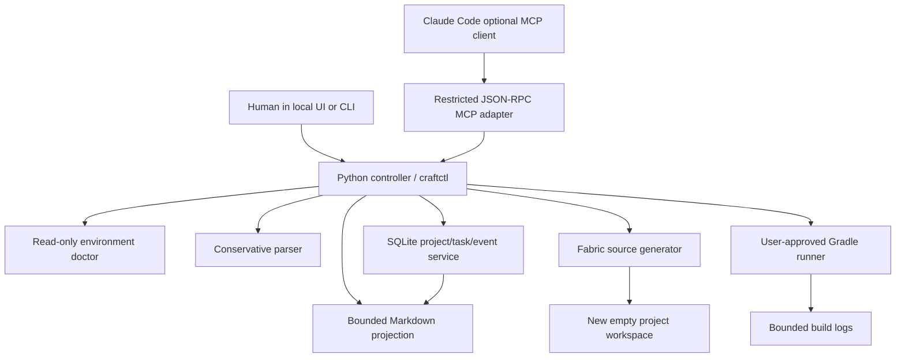
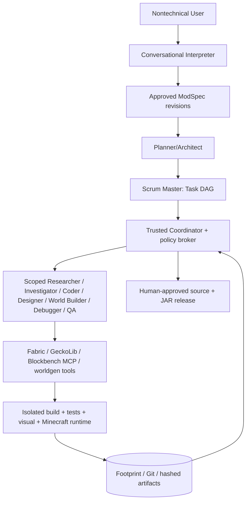

# Architecture: implemented foundation versus target

## Current implementation (v0.1)



### Implemented primitive boundaries

- **Agent:** Claude Code file-based prompts in `.claude/agents`; optional adapter only. No built-in LLM runtime yet.
- **Skill:** procedural Markdown in `.claude/skills/` with scope, references, safeguards and return contract.
- **Tool:** typed `craftctl` CLI/MCP operations for diagnostics, spec, planning, generation, validation, state and Gradle build.
- **Hook / service:** SQLite state transitions are authoritative; developer hooks are a future supplemental mechanism.

**What is explicitly not implemented:** arbitrary spec planning with an AI, concurrent Git worktree integration, rich schema migrations, E2E gameplay automation, live JVM log streams, managed Gradle/JDK installation, OS sandboxes, Blockbench MCP bridge, approval transactions for arbitrary external plugins, provider-neutral AI inference. These are sequenced in the roadmap.

## Data flow and source-of-truth

1. User describes idea; the raw idea is retained. Current parser recognizes `items:` and `blocks:` only.
2. Unsupported or consequential advanced terms create blocking questions.
3. User approves the typed specification. The controller records a SQLite event and completes a task with evidence.
4. Scrum-like task graph tracks interpreter, scaffold, feature generation, build and gameplay check dependencies.
5. Deterministic generator writes a **new** Fabric folder. Source code, JSON metadata, 16x16 PNG placeholders and file SHA-256 hashes are produced.
6. `validate` checks manifest integrity and JSON parseability; it **does not compile or launch** the mod.
7. Gradle builds require an approval record that matches the exact project, action and version context; same token cannot be replayed.
8. A successful build advances status to `BUILD_PASSED_GAME_UNTESTED`; game testing remains a separate task.

## Trust boundary

```mermaid
flowchart LR
  U[User] --> UI[Local authenticated UI/CLI]
  UI -->|Approves concrete request| Core[Local controller]
  LLM[Potentially untrusted LLM/plugin] -->|Restricted tool call| MCP[MCP facade]
  MCP --> Core
  Core --> DB[(SQLite Footprint)]
  Core --> Files[Managed new workspaces]
  Core -->|Only user-approved| Gradle[Unsandboxed Gradle process (pre-alpha)]
```

- This local tool controller **does not** sandbox arbitrary shell-capable agents or untrusted Gradle scripts. Role definitions and hooks must not be sold as security enforcement.
- MCP doesn't expose permission granting or direct arbitrary commands. A Claude agent still may have other terminal privileges granted by the user's Claude Code settings; secure deployment requires OS isolation and permission hardening.
- Workspaces are only created within `CRAFTCTL_HOME/projects`. Symlink escape attempts are rejected by the generated file writer. There is not yet an atomic workspace staging/rename transaction; recovery is required after partial disk failure.

## Fabric generator

The `fabric-1.21.1-candidate` profile mirrors the official FabricMC example mod (branch `1.21.1`, commit `684b581`): Minecraft 1.21.1, **Mojang official mappings**, Loom 1.18 (`net.fabricmc.fabric-loom-remap`), Loader 0.19.5, Fabric API 0.116.17+1.21.1, Gradle 9.7.1; JDK 25 runs Gradle, sources compile with `--release 21`. Generator output has been build-verified and tested in-game (2026-10-20; `examples/crystal_example/EVIDENCE.md`). Evidence levels `BUILD_PASS` (controller, from an approved build) and `CLIENT_BOOT_PASS` / `SERVER_BOOT_PASS` / `CONTENT_VERIFIED` (user-only, `craftctl evidence`) are stored per project with the workspace manifest hash and JAR SHA-256; all three game levels promote a project to `GAME_VERIFIED`. A verified profile is only promoted after Gradle client and dedicated server checks.

## Target architecture (from v2 master plan)



Missing infrastructure is deliberately staged in `docs/ROADMAP.md`; do not confuse this diagram with shipping features.

## State DB schema versioning (STA-001)

`state.MIGRATIONS` is an append-only list of `(version, title, sql)`. `Store()` reads `PRAGMA user_version`; a fresh DB gets every step, an older DB gets only the missing steps (each in its own transaction, `user_version` bumped per step) after a `state.sqlite.bak-v<N>` copy made with the SQLite backup API, and a DB whose version is newer than the code refuses to open. Never edit a shipped step; add a new one. `craftctl doctor` reports `schema.version` vs `schema.current`.

## Atomic workspace install (SEC-001)

`fabric.generate` never writes to `projects/<id>/` directly. Files are written and hash-validated in `projects/.staging/<name-slug>-<id>-<UTC stamp>-<4 hex>/` (slug omitted when it equals the id) and then moved into place with a single `os.replace`. The final path therefore either does not exist or holds a complete, validated workspace; a crash leaves only a staging directory, which `craftctl doctor` lists and the next `generate` sweeps once it is older than one hour. A non-empty or symlinked final path is refused before any staging work starts.

## Process broker (SEC-002)

`broker.run_logged` is the only place the controller spawns an external process. The child gets a minimal allow-listed environment (never `os.environ` wholesale), runs in its own session/process group, writes stdout+stderr to the project log file, and on timeout (`CRAFTCTL_BUILD_TIMEOUT`, default 1800 s) the whole process tree is killed (`killpg` / `taskkill /T`). The Footprint records pid, duration, exit code and whether it was killed.

## Redaction (SEC-003)

`redact.redact` scrubs the user home (`~`), the craftctl home (`<craftctl-home>`), the projects root (`<projects>`) and common secret shapes (GitHub tokens, bearer tokens, `key=value` credentials, AWS keys, private keys) from everything that leaves the local trust boundary: every event payload (single choke point in `Store.event`), approval descriptions, `craftctl logs` / `diagnose` excerpts, and agent handoff packets. The on-disk build log stays verbatim for the user.

## Controller-driven dispatch (R2)

`dispatch.dispatch(store, project, task_id?, provider?)` is the only way an agent is started from application state: pick a READY task → lease it as `agent:<role>` → build a `TaskEnvelope` (bounded, redacted handoff packet + workspace) → `provider.run` → validate the handoff → map it onto the task → record the run. Workers never set task state; their handoff `status` is a claim the controller checks.

- `provider.AgentProvider` is the interface (`run(envelope, log) -> RunResult`, synchronous, one worker). `ClaudeCodeProvider` runs the user's installed Claude Code headless (`claude -p … --agent <role> --agents <json> --settings <json> --mcp-config <json> --strict-mcp-config --permission-mode acceptEdits --max-turns N --output-format json`) through the process broker, with the workspace as cwd, the packaged agents/skills/guard/deny rules from `src/mod_orchestra/resources/claude/` (kept byte-identical to `.claude/`, test-enforced) and the user's own login — no API key in v1. `FakeProvider` replays a scripted reply for tests and `craftctl dispatch --provider fake`.
- Handoff contract: a fenced ```` ```handoff ```` JSON block with `task, status (DONE|WAITING_USER|BLOCKED|FAILED), scope, changed_files, checks_run[{command, exit_code}], evidence{level, pointer}, risks, unknowns, needs_user, next_agent`. Workers may claim only `STATIC | BUILD_PASS | BUILD_FAILED | NONE`; `BUILD_PASS` needs a gradle command with exit 0 in `checks_run`; `DONE` may not carry `needs_user`. Anything else fails the run and the task (`last_error`), and `craftctl requeue` returns it to READY.
- Task states: `BACKLOG, READY, LEASED, RUNNING, DONE, WAITING_USER, BLOCKED, FAILED, CANCELLED`. `runs` table (schema v3) records provider, timing, exit code, log path, session id, cost, turns and the accepted handoff.
- USER-ONLY around dispatch: `craftctl dispatch`, `requeue`, `add-task` (denied to agents by settings and guard).
