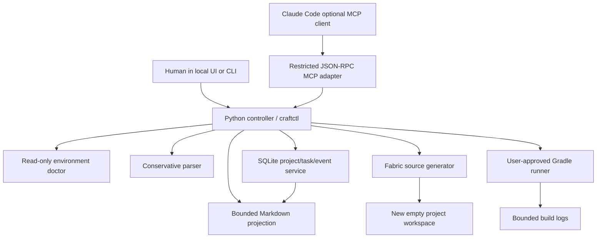
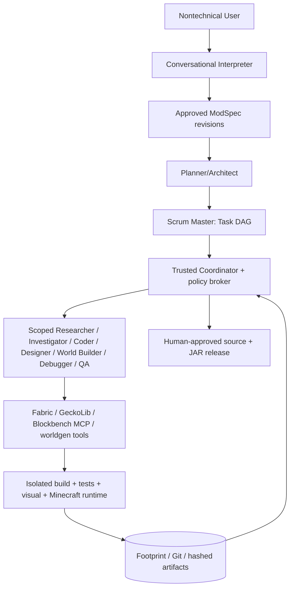

# Architecture: implemented foundation versus target

## Current implementation (v0.1)



### Implemented primitive boundaries

- **Agent:** Claude Code file-based prompts in `.claude/agents`; optional adapter only. No built-in LLM runtime yet.
- **Skill:** procedural Markdown in `.claude/skills/` with scope, references, safeguards and return contract.
- **Tool:** typed `craftctl` CLI/MCP operations for diagnostics, spec, planning, generation, validation, state and Gradle build.
- **Hook / service:** SQLite state transitions are authoritative; developer hooks are a future supplemental mechanism.

**What is explicitly not implemented:** arbitrary spec planning with an AI, concurrent Git worktree integration, rich schema migrations, E2E gameplay automation, live JVM log streams, managed Gradle/JDK installation, OS sandboxes, Blockbench MCP bridge, approval transactions for arbitrary external plugins, provider-neutral AI inference. These are sequenced in the roadmap.

## Data flow and source-of-truth

1. User describes idea; the raw idea is retained. Current parser recognizes `items:` and `blocks:` only.
2. Unsupported or consequential advanced terms create blocking questions.
3. User approves the typed specification. The controller records a SQLite event and completes a task with evidence.
4. Scrum-like task graph tracks interpreter, scaffold, feature generation, build and gameplay check dependencies.
5. Deterministic generator writes a **new** Fabric folder. Source code, JSON metadata, 16x16 PNG placeholders and file SHA-256 hashes are produced.
6. `validate` checks manifest integrity and JSON parseability; it **does not compile or launch** the mod.
7. Gradle builds require an approval record that matches the exact project, action and version context; same token cannot be replayed.
8. A successful build advances status to `BUILD_PASSED_GAME_UNTESTED`; game testing remains a separate task.

## Trust boundary

```mermaid
flowchart LR
  U[User] --> UI[Local authenticated UI/CLI]
  UI -->|Approves concrete request| Core[Local controller]
  LLM[Potentially untrusted LLM/plugin] -->|Restricted tool call| MCP[MCP facade]
  MCP --> Core
  Core --> DB[(SQLite Footprint)]
  Core --> Files[Managed new workspaces]
  Core -->|Only user-approved| Gradle[Unsandboxed Gradle process (pre-alpha)]
```

- This local tool controller **does not** sandbox arbitrary shell-capable agents or untrusted Gradle scripts. Role definitions and hooks must not be sold as security enforcement.
- MCP doesn't expose permission granting or direct arbitrary commands. A Claude agent still may have other terminal privileges granted by the user's Claude Code settings; secure deployment requires OS isolation and permission hardening.
- Workspaces are only created within `CRAFTCTL_HOME/projects`. Symlink escape attempts are rejected by the generated file writer. There is not yet an atomic workspace staging/rename transaction; recovery is required after partial disk failure.

## Fabric generator

The `fabric-1.21.1-candidate` profile mirrors the official FabricMC example mod (branch `1.21.1`, commit `684b581`): Minecraft 1.21.1, **Mojang official mappings**, Loom 1.18 (`net.fabricmc.fabric-loom-remap`), Loader 0.19.5, Fabric API 0.116.17+1.21.1, Gradle 9.7.1; JDK 25 runs Gradle, sources compile with `--release 21`. Generator output has been build-verified and tested in-game (2026-10-20; `examples/crystal_example/EVIDENCE.md`). Evidence levels `BUILD_PASS` (controller, from an approved build) and `CLIENT_BOOT_PASS` / `SERVER_BOOT_PASS` / `CONTENT_VERIFIED` (user-only, `craftctl evidence`) are stored per project with the workspace manifest hash and JAR SHA-256; all three game levels promote a project to `GAME_VERIFIED`. A verified profile is only promoted after Gradle client and dedicated server checks.

## Target architecture (from v2 master plan)



Missing infrastructure is deliberately staged in `docs/ROADMAP.md`; do not confuse this diagram with shipping features.

## State DB schema versioning (STA-001)

`state.MIGRATIONS` is an append-only list of `(version, title, sql)`. `Store()` reads `PRAGMA user_version`; a fresh DB gets every step, an older DB gets only the missing steps (each in its own transaction, `user_version` bumped per step) after a `state.sqlite.bak-v<N>` copy made with the SQLite backup API, and a DB whose version is newer than the code refuses to open. Never edit a shipped step; add a new one. `craftctl doctor` reports `schema.version` vs `schema.current`.

## Atomic workspace install (SEC-001)

`fabric.generate` never writes to `projects/<id>/` directly. Files are written and hash-validated in `projects/.staging/<name-slug>-<id>-<UTC stamp>-<4 hex>/` (slug omitted when it equals the id) and then moved into place with a single `os.replace`. The final path therefore either does not exist or holds a complete, validated workspace; a crash leaves only a staging directory, which `craftctl doctor` lists and the next `generate` sweeps once it is older than one hour. A non-empty or symlinked final path is refused before any staging work starts.

## Process broker (SEC-002)

`broker.run_logged` is the only place the controller spawns an external process. The child gets a minimal allow-listed environment (never `os.environ` wholesale), runs in its own session/process group, writes stdout+stderr to the project log file, and on timeout (`CRAFTCTL_BUILD_TIMEOUT`, default 1800 s) the whole process tree is killed (`killpg` / `taskkill /T`). The Footprint records pid, duration, exit code and whether it was killed.

## Redaction (SEC-003)

`redact.redact` scrubs the user home (`~`), the craftctl home (`<craftctl-home>`), the projects root (`<projects>`) and common secret shapes (GitHub tokens, bearer tokens, `key=value` credentials, AWS keys, private keys) from everything that leaves the local trust boundary: every event payload (single choke point in `Store.event`), approval descriptions, `craftctl logs` / `diagnose` excerpts, and agent handoff packets. The on-disk build log stays verbatim for the user.

## Controller-driven dispatch (R2)

`dispatch.dispatch(store, project, task_id?, provider?)` is the only way an agent is started from application state: pick a READY task → lease it as `agent:<role>` → build a `TaskEnvelope` (bounded, redacted handoff packet + workspace) → `provider.run` → validate the handoff → map it onto the task → record the run. Workers never set task state; their handoff `status` is a claim the controller checks.

- `provider.AgentProvider` is the interface (`run(envelope, log) -> RunResult`, synchronous, one worker). `ClaudeCodeProvider` runs the user's installed Claude Code headless (`claude -p … --agent <role> --agents <json> --settings <json> --mcp-config <json> --strict-mcp-config --permission-mode acceptEdits --max-turns N --output-format json`) through the process broker, with the workspace as cwd, the packaged agents/skills/guard/deny rules from `src/mod_orchestra/resources/claude/` (kept byte-identical to `.claude/`, test-enforced) and the user's own login — no API key in v1. `FakeProvider` replays a scripted reply for tests and `craftctl dispatch --provider fake`.
- Handoff contract: a fenced ```` ```handoff ```` JSON block with `task, status (DONE|WAITING_USER|BLOCKED|FAILED), scope, changed_files, checks_run[{command, exit_code}], evidence{level, pointer}, risks, unknowns, needs_user, next_agent`. Workers may claim only `STATIC | BUILD_PASS | BUILD_FAILED | NONE`; `BUILD_PASS` needs a gradle command with exit 0 in `checks_run`; `DONE` may not carry `needs_user`. Anything else fails the run and the task (`last_error`), and `craftctl requeue` returns it to READY.
- Manifest revisions: when a run ends DONE or WAITING_USER with `changed_files`, the controller re-hashes the union of files reported by every run of that task and appends a revision `{run, actor, at, files}` to `generation-manifest.json` (`CHANGES_ACCEPTED` event). `validate` overlays revisions on the generation hashes, so agent edits are attributable and buildable through `request-build`, while any file that differs but was not reported stays `CHANGED` (unreported = tampered).
- Task states: `BACKLOG, READY, LEASED, RUNNING, DONE, WAITING_USER, BLOCKED, FAILED, CANCELLED`. `runs` table (schema v3) records provider, timing, exit code, log path, session id, cost, turns and the accepted handoff.
- `dispatch.orchestrate` is the coordinator loop: dispatch READY tasks one after another until a WAITING_USER/BLOCKED/FAILED outcome (the user is needed) or a budget is hit (`--max-runs`, `--max-cost-usd`, `--max-seconds`). It first reconciles runs left RUNNING by a controller that died (restart safety); task leases expire on their own.
- USER-ONLY around dispatch: `craftctl dispatch`, `orchestrate`, `requeue`, `add-task`, `accept-changes` (denied to agents by settings and guard). The UI can call them: it is the authenticated local user.

## Repair loop and server smoke (R5)

- `repair.open_repair_task` creates `<project>:REPAIR:<n>` for the **debugger** whenever a build fails: from `craftctl build` (exit ≠ 0), from a worker whose handoff reports `evidence.level: BUILD_FAILED`, or from a failed server smoke. The repair packet appends the `diagnose` classification, the build log tail and, if present, the server-smoke lines mentioning the mod. Repairs are dispatched before any other READY task. After `MAX_ATTEMPTS` (3) failed repairs in one episode the loop emits `REPAIR_EXHAUSTED`, blocks, and `orchestrate` stops with the reason. A repair that reaches `DONE` closes the episode; the user's trusted `craftctl build` confirms it.
- `craftctl break <project> --fault {missing-import|wrong-mapping|bad-loot-json}` (USER-ONLY fixture) injects one known failure as a user-attributed manifest revision: two compile failures and one server-side datapack failure (valid JSON, unknown item id) that only the dedicated server reports.
- `craftctl request-smoke` / `server-smoke` run `gradlew runServer` in the project's isolated `run/` under a one-use approval whose text states it accepts the Minecraft EULA in `run/eula.txt`. `broker.run_watch` tails the log until `Done (…)!`, then sends `stop` and kills the tree if it does not exit. The controller records `SERVER_BOOT_PASS` itself when the mod is in the loaded list and no ERROR/FATAL/Exception line mentions the mod; otherwise it opens a repair task. Client boot and in-game content remain user-only evidence.

## Static content (v1 criterion 2)

Spec schema 2 adds `recipes` (shaped / shapeless / smelting / blasting / smoking / campfire_cooking, with counts, namespaced vanilla ids and `#tags`), `drops` (ore-style loot: item with count range, Fortune `ore_drops`, Silk Touch returns the block) and `tab` / `tab_icon` (own `CreativeModeTab` via `FabricItemGroup`). The generator renders vanilla 1.21.1 JSON (`recipe/`, `advancement/recipes/` unlock advancements, `loot_table/blocks/`) and the Java tab registration. Before generation the user fills these with `craftctl add-recipe / add-drop / set-tab` (every edit returns the spec to DRAFT); in R3 the interpreter agent fills the same fields from the user's words. The shared `recipes` skill carries the formats and the standard tool/armor patterns for agents writing JSON after generation.

## Conversational interpreter (R3, v1 criterion 1)

`craftctl new` accepts free text; if the deterministic grammar extracts nothing, the project is created with one open question and the `<project>:SPEC` task (role interpreter) is the only task dispatchable before approval. The interpreter worker receives the idea plus `interpreter.SPEC_INSTRUCTIONS` (the exact schema-2 proposal shape and the validation rules) and returns `spec` + at most three `questions` in its handoff with status WAITING_USER. The controller validates the proposal with the same rules as `craftctl add-recipe/add-drop/set-tab` (`interpreter.spec_from_proposal`; identity fields cannot be changed by the worker), stores it as the DRAFT spec (`SPEC_PROPOSED`), and parks the task: `craftctl answer <id> "..."` appends the answer to the idea and reopens the task; `craftctl approve-spec` closes it. Rejected proposals fail the run and leave the stored spec untouched. `craftctl interpret-suite` runs `tests/v1/prompts/*.json` through the real interpreter and scores them into `tests/v1/results/`.

## Mobs (R6 scaffold, v1 criterion 6)

Spec `mobs` (`craftctl add-mob`, grammar `mobs: a, b` / `hostile mobs: c`, or the interpreter) → `geckolib.py` emits, per mob: `entity/<Name>Entity.java` (`PathfinderMob` or `Monster` implementing `GeoEntity`, attributes, vanilla goals, one `AnimationController` switching idle/walk on `isMoving()`), `client/<Name>Renderer.java` (`GeoEntityRenderer` + `DefaultedEntityGeoModel`), `client/ModClient.java` (`EntityRendererRegistry`), `EntityType` + `SpawnEggItem` registration and `FabricDefaultAttributeRegistry` in `ModMain`, entity loot table, lang, and placeholder assets in the `DefaultedEntityGeoModel` layout (`geo/entity/<id>.geo.json` — the six-bone quadruped validated with the headless Blockbench MCP —, `animations/entity/<id>.animation.json` idle+walk, `textures/entity/<id>.png` 64×32). `build.gradle` gains the GeckoLib Cloudsmith repository and `modImplementation software.bernie.geckolib:geckolib-fabric-1.21.1:4.7.3` only when the spec has mobs; `fabric.mod.json` adds the `client` entrypoint and `geckolib >= 4.7`. Each egg also gets `models/item/<id>_spawn_egg.json` (`minecraft:item/template_spawn_egg`, tinted from the two `egg_colors`, which `default_egg_colors()` derives from the identifier so two eggs never look alike: dark base for hostile, bright for passive) and the entity loot table uses the 1.21 `enchanted_count_increase` function. Vanilla logs `No data fixer registered for <id>` at ERROR for every modded `EntityType` without a DataFixer schema entry; it is harmless and `smoke.BENIGN` keeps it from opening a repair. Verified in Round 4 (scratch workspace from the same spec): `gradlew build` passes against GeckoLib 4.7.3, the dedicated server boots with the mod and GeckoLib loaded. The designer worker (next slice) replaces the placeholders with a real `.bbmodel` exported to geo + animation.
