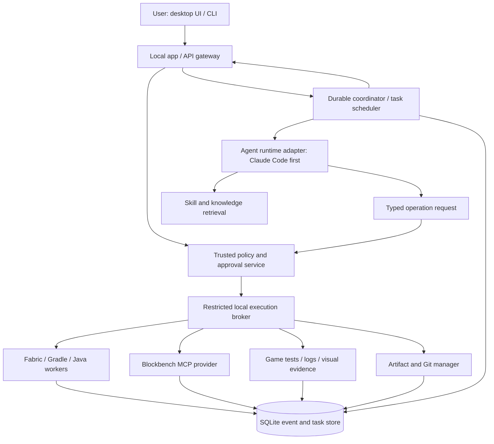
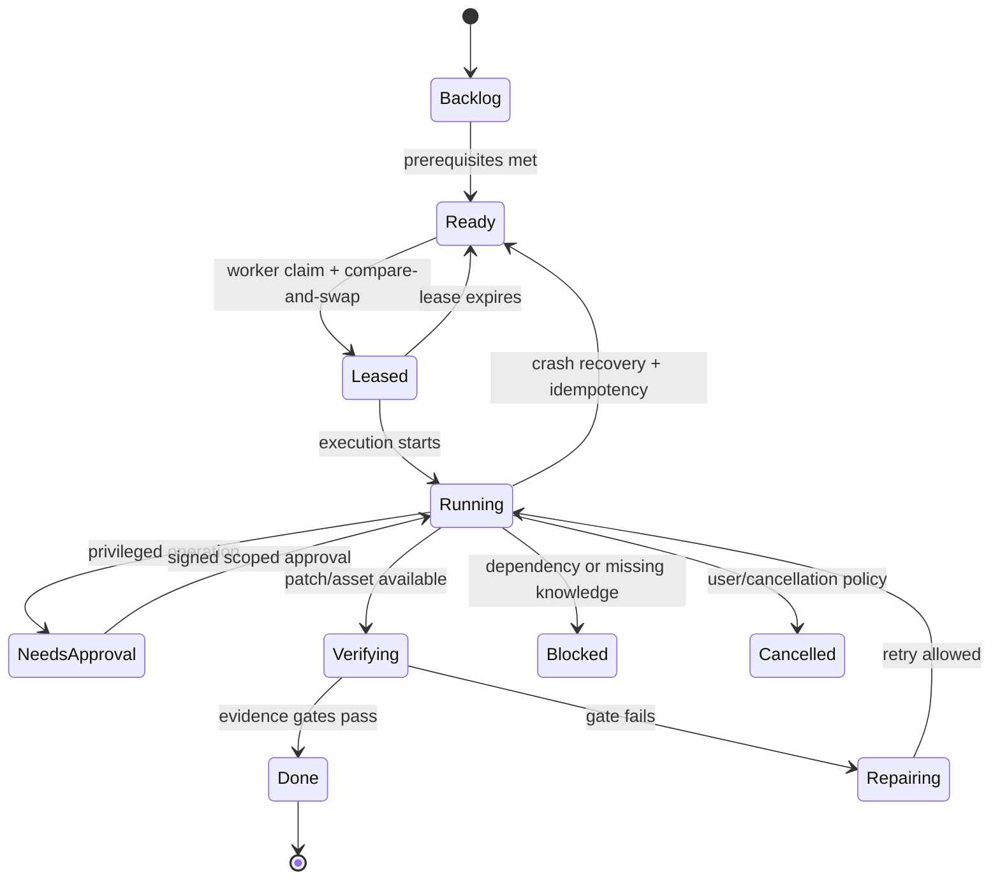

# Minecraft Java Modding Orchestra — Master Plan, Reviewed and Expanded (v2)


> **Revision 2 — 19 October 2026.** This preserves the complete original research and adds a detailed engineering implementation specification in **Part II**. Part II has precedence where recommendations differ, especially on security, exact version pinning, user-experience requirements and durable orchestration. Confirmed product constraints: **hybrid deployment, Fabric-first loader, approval-based autonomy**. This is a plan—not a completed build.

**Read this in two passes:** Part I explains the research, agents and Minecraft workflows. [Part II](#part-ii--version-2-architecture-review-corrections-and-implementation-specification) closes the execution, security, compatibility, permission, UX, quality and delivery gaps with enforceable contracts.

## Revision 2 at a glance

- **Retained:** Interpreter → Planner → Scrum → Coordinator; Researcher/Investigator/Coder/Designer/World Builder/Debugger; Fabric + GeckoLib + Blockbench; SQLite Footprint + versioned skills/KB; milestone-based delivery.
- **Added:** trusted local policy broker, strict approval transactions, isolated workers, version-locked toolchains, concurrent task leases and worktrees, model-provider adapters, end-user desktop UX, structured interfaces, multiplayer/save/performance testing and a security-negative benchmark suite.
- **Corrected:** Claude Code is our *first* agent adapter, not an adequate security boundary or mandatory final product dependency; the target Minecraft version must be verified rather than assumed.

---

# Part I — Original research and baseline design (retained)

## Executive direction

The project should not be built as “one giant Minecraft AI agent.” The strongest architecture is a **Minecraft-specific orchestration layer** where Claude Code acts as the reasoning runtime, specialized subagents handle bounded responsibilities, reusable Skills contain Minecraft procedures, MCP servers expose deterministic external capabilities, Hooks enforce workflow/state rules, and a compact persistent knowledge system prevents every new session from rediscovering the same problems.

That separation matches how Claude Code itself is designed: subagents get isolated context and specialized tool access; Skills package reusable procedures in `SKILL.md`; Hooks execute deterministic behavior at lifecycle events; and MCP connects the model to external tools and systems. Claude Code already provides filesystem operations, code search, command execution, Git, and web access, so recreating those as MCP servers would mostly add complexity rather than capability. citeturn23search0turn23search1turn23search6turn23search9

My recommended target architecture is:

```text
                         ┌───────────────────────┐
                         │         USER          │
                         │ "make me this mod..." │
                         └───────────┬───────────┘
                                     │
                                     ▼
                         ┌───────────────────────┐
                         │     INTERPRETER       │
                         │ Resolve requirements  │
                         │ Ask critical questions│
                         └───────────┬───────────┘
                                     │
                            MOD_SPEC.yaml/md
                                     │
                                     ▼
                         ┌───────────────────────┐
                         │       PLANNER         │
                         │ Architecture + slices │
                         │ versions + dependencies│
                         └───────────┬───────────┘
                                     │
                              MOD_PLAN.md
                                     │
                                     ▼
                         ┌───────────────────────┐
                         │     SCRUM MASTER      │
                         │ Task DAG + milestones │
                         └───────────┬───────────┘
                                     │
                                     ▼
                  ┌────────────────────────────────┐
                  │          COORDINATOR           │
                  │ dispatch / gates / arbitration │
                  └───────┬──────┬──────┬─────────┘
                          │      │      │
         ┌────────────────┘      │      └────────────────┐
         ▼                       ▼                       ▼
   RESEARCHER               INVESTIGATOR               CODER
 official docs              existing code             Java/code
 upstream source             dependencies               data
         │                       │                       │
         ├──────────────┬────────┼───────────┬───────────┤
                        ▼                    ▼
                    DESIGNER           WORLD BUILDER
                Blockbench/GeckoLib    world generation
                textures/models       biomes/features
                rigs/animations       structures/spawns
                        │                    │
                        └────────┬───────────┘
                                 ▼
                         DEBUGGER / QA
                       compile → runtime
                     logs → tests → game
                                 │
                                 ▼
                    COMPATIBILITY / RELEASE
                    package / loader / port
                                 │
                                 ▼
                           MOD .JAR + SOURCE


     ╔══════════════════════════════════════════════════════╗
     ║                 CROSS-CUTTING SYSTEMS                ║
     ║                                                      ║
     ║ Footprint / State DB    Knowledge Base    Git        ║
     ║ Hooks                   MCP tools         Evidence   ║
     ╚══════════════════════════════════════════════════════╝
```

The most important design decision is that **not everything the user described should literally be an AI agent**.

For example, your `Foot-print` concept is excellent, but making it an LLM worker would make the history less reliable. It should instead be a deterministic state service driven by Hooks. Every agent action, task transition, important command, test result, artifact, Git commit and failure gets recorded automatically. Claude Code Hooks are specifically intended to run code before or after actions, at session lifecycle points, and around subagents, making them a better foundation for guaranteed logging than telling an agent “please remember to update the log.” citeturn23search2turn23search6turn23search11

Similarly, “Scrum Master” is principally a **planning Skill plus task-state service**, not necessarily a constantly-running agent. The Coordinator can invoke it whenever a plan changes. This matters because separate subagents have their own context and cost; Anthropic recommends subagents for isolated work that would otherwise flood the main context rather than creating one for every conceptual responsibility. Claude Code now also supports coordinated parallel agents and agent teams, but those should be selectively enabled when independent work can actually proceed in parallel. citeturn23search0turn23search4turn23search15

The project should therefore think in four primitives:

| Primitive | What belongs there | Examples |
|---|---|---|
| **Agent** | Reasoning role requiring isolated context | Researcher, Designer, Debugger |
| **Skill** | Repeatable domain procedure | create-item, add-GeckoLib-entity, debug-registry-error |
| **MCP / CLI tool** | Deterministic external action | Blockbench edit, log tail, Gradle run, state query |
| **Hook / state service** | Workflow enforcement | event logging, validation, task-state update |

This is also a major lesson from **Universal Modder**. It already separates Skills, agents, tools, Hooks and a shared knowledge base. Its workflow is effectively: search prior knowledge, recon, establish a safe environment, read the real implementation, build one working slice, make assets, verify in the actual game, record the result, package it, and write a field note. Its `um` CLI separately exposes deterministic capabilities such as scanning, asset generation, game automation, backup, publishing checks and knowledge-base operations. citeturn18search0turn18search3

**We should borrow that architecture aggressively rather than fork the entire project.**

Universal Modder is MIT licensed and has a broad “almost any PC game” mission, whereas ours can go dramatically deeper into Minecraft-specific concepts: loaders, registries, datagen, entities, networking, Blockbench, GeckoLib, worldgen, GameTests, Minecraft version migration and mod compatibility. citeturn18search0turn18search3

The outcome is essentially:

> **Universal Modder philosophy + Minecraft-specialized expertise + Blockbench AI + automated Gradle/game testing + persistent development memory.**

And the actual promise should be slightly more precise than “literally any imaginable mod.”

The system should aim to transform **any sufficiently specified mod idea into an implementation attempt**, and autonomously handle known categories while escalating novel mechanics into research and source investigation. No architecture can guarantee arbitrary functionality across every Minecraft version, loader, incompatible dependency, rendering requirement or undocumented engine behavior. Version churn alone makes that impossible to guarantee: for example, Fabric's current documentation pages retrieved during this research are on 26.2 while its tooling and project ecosystem continue evolving, and NeoForge has independent version-specific MDKs and tooling. citeturn16search0turn17search1turn21search2

That is not a weakness. It tells us what differentiates this project from a template generator:

**When the system does not already know how to implement something, it should know how to learn how.**

## Foundations and what we should reuse

The guiding rule for this project should be:

> **Own orchestration and Minecraft-specific intelligence. Reuse mature infrastructure everywhere else.**

We should resist recreating project generators, Blockbench, GeckoLib, loader toolchains, testing systems, asset generators or generic web/code search.

### Loader foundation

I recommend **Fabric as the first fully-supported execution path**, followed by NeoForge through a loader abstraction.

This is not because NeoForge is inferior. It is because Fabric gives us a particularly straightforward first autonomous pipeline: an official template generator/example project, Fabric Loom, extensive developer documentation, datagen, automated testing and GameTest support. Fabric's template generator already creates version-specific mod workspaces and can optionally enable datagen; its official documentation describes unit testing through Fabric Loader JUnit and actual client/server gameplay tests through Minecraft's GameTest framework. citeturn16search0turn21search2turn21search3

NeoForge should be the second backend, using **its own official generator and MDKs**, not a template that we maintain ourselves. NeoForge maintains a browser/CLI mod generator, per-version MDKs, and ModDevGradle can create compilation artifacts and run Minecraft from Gradle or IntelliJ for development/testing. citeturn17search0turn17search1turn17search2turn17search6

Our abstraction therefore becomes:

```text
ModProjectProvider
│
├── FabricProvider
│   ├── scaffold()
│   ├── inspect()
│   ├── build()
│   ├── runClient()
│   ├── runServer()
│   ├── datagen()
│   └── test()
│
├── NeoForgeProvider
│   ├── scaffold()
│   ├── inspect()
│   ├── build()
│   ├── runClient()
│   ├── runServer()
│   ├── datagen()
│   └── test()
│
└── MultiLoaderProvider
    └── later milestone
```

Eventually, we should support a true common-source multi-loader layout, but we do **not** need to invent that Gradle architecture either. Jared's CC0 MultiLoader Template already exists specifically to compile mods for multiple mod loaders from a shared common project, and it does so without requiring a third-party abstraction library. citeturn21search0

Therefore:

**MVP:** Fabric.

**Next:** NeoForge.

**Later:** an optional `common + fabric + neoforge` project mode based on an existing MultiLoader template.

The orchestration system itself must remain loader-independent from day one.

### Fabric datagen instead of hand-writing everything

A major source of hallucination and tiny JSON errors can be eliminated with datagen.

Fabric's datagen APIs can programmatically generate recipes, advancements, tags, item models, translations, loot tables and other JSON-based resources. Fabric's current documentation also includes generators specifically for blocks, items and world-generation features. citeturn21search2turn21search6turn21search18turn21search21turn21search24turn21search27

Our Coder should therefore follow this policy:

```text
Can official datagen create it?
       │
       ├── YES → generate it through datagen
       │
       └── NO  → author resource manually
```

That gives us compile-time Java APIs and repeatable generation instead of having agents manufacture dozens of loosely-related JSON files by hand.

### GeckoLib

GeckoLib absolutely belongs in the standard stack rather than implementing our own animated entity system.

The project supports complex keyframe animation, easings, concurrent animations, sound/particle/event keyframes and major loaders including Fabric, Forge and NeoForge. The GeckoLib project itself is MIT-licensed. citeturn21search1

Even more importantly for our system, GeckoLib already treats Blockbench as part of the authoring workflow. Its documentation covers creating the model hierarchy and pivots in Blockbench, animations, animation controllers, Geo models, animated items and the mapping between model, texture and animation resources. citeturn24search2turn24search3turn24search4turn24search6

The official `geckolib-examples` repository should become one of our most important reference sources. It intentionally contains working example mods for major loaders/version branches and is designed to show minimal deployments using GeckoLib features. citeturn16search1

Instead of our agents trying to remember GeckoLib wiring from model knowledge:

```text
Researcher:
    inspect matching geckolib-examples branch

Investigator:
    map relevant working pattern

Coder:
    adapt pattern to project's package/version

Designer:
    generate corresponding Blockbench assets

Debugger:
    validate model + animation + in-game renderer
```

This dramatically reduces hallucinated API use.

### Blockbench and the Designer stack

Blockbench itself should remain the actual model editor. It has an official plugin API and generated reference documentation intended for plugin developers, so an MCP bridge is the right layer rather than writing our own modeling software. citeturn20search0turn20search1

After investigating the available MCP projects, I would **not** choose a single one permanently today.

I would establish this provider stack:

| Provider | Role in our system | Why |
|---|---|---|
| **minecraft-blockbench-mcp by adhi-jp** | Primary candidate for live Minecraft/GeckoLib authoring | Strong Minecraft-specific tool surface, explicit GeckoLib operations, undo/scoped filesystem/security architecture |
| **jasonjgardner/blockbench-mcp-plugin** | Headless/offline model worker | Can directly edit, validate, convert and render `.bbmodel` files without Blockbench running |
| **sosadly/blockbench-mcp** | Experimental high-level live Designer | Large Minecraft-specific modeling/texturing/rigging/animation toolset |
| **img2blockbench** | Reference-image → Blockbench pipeline | Purpose-built conversion of Minecraft-style concept images into native Blockbench models |

The adhi-jp MCP was the strongest **architectural fit** in the repository analysis: it exposes Java block/item and GeckoLib project operations through a local Blockbench bridge, provides model/animation validation and frame capture, scopes filesystem access, uses a shared secret, rejects symlink escapes and uses Blockbench undo semantics. citeturn8view0

However, I would **not claim it has proven superior visual output**. I found no public apples-to-apples benchmark comparing these MCPs on identical Minecraft model prompts. That means “which produces the best-looking models?” should become one of our own benchmark suites instead of an assumption.

Jason Gardner's project is particularly interesting for parallelism because its separate stdio server can edit, validate, convert and render `.bbmodel` files headlessly, and each worker can use an independent process. It also supports a live desktop MCP. The repository is GPL-3.0, so I recommend treating it as an external provider rather than copying its implementation into a permissively licensed core. citeturn18search1turn19search2

`sosadly/blockbench-mcp` currently advertises 70 tools covering model construction, procedural details, texture creation, rigging, animation, screenshots and export, including Minecraft Java, Bedrock and GeckoLib formats. Its procedural tools are especially interesting because operations such as arrays, chains, wings and hollow volumes move geometric arithmetic out of the language model. citeturn18search2turn19search0

`img2blockbench` is complementary rather than competing. It converts Minecraft-style reference art into native Blockbench models through multiple routes, including direct cuboid/texture reasoning and reconstruction from 3D guidance, and is MIT-licensed. citeturn19search1turn19search5

That gives the Designer a powerful route:

```text
Text idea
   │
   ├── no concept art
   │      ↓
   │   direct Blockbench MCP generation
   │
   └── concept/reference image
          ↓
      img2blockbench
          ↓
      live Blockbench MCP refinement
          ↓
      screenshots / validation
          ↓
      GeckoLib export
```

For pure texture concept generation, we can also reuse Universal Modder's existing asset stack rather than build another AI image API wrapper. Universal Modder already wraps fal-based image/sprite/texture/3D generation, local ComfyUI, sprite processing and generation manifests through its `um` CLI. citeturn18search0

That makes `um fal`, `um comfy` and selected asset utilities potential **optional providers** behind our Designer rather than dependencies baked into the core.

### What to take from Universal Modder

Universal Modder's repository is extremely useful because it already validates several architectural ideas we need. It ships Agent Skills, MCP configuration, a Python CLI, Hooks, specialized agents and an AI-written knowledge base across Claude Code, Codex, Gemini CLI, Cursor and other agent environments. citeturn18search0

I would directly adapt these ideas:

| Universal Modder pattern | Our Minecraft-specialized version |
|---|---|
| `mod-orchestrator` | `minecraft-coordinator` |
| live game worker | Debugger/Test worker |
| offline worker | Researcher/Investigator/Coder workers |
| `um kb` | `craftctl kb` |
| field notes | Minecraft recipes + gotchas |
| one working slice | vertical-slice implementation policy |
| `um backup` | workspace/world backup |
| `um publish check` | release/license/secret/resource audit |
| `um fal` | optional Designer asset provider |
| `um win shot/drive` | optional live-client visual automation |
| manifest every asset generation | provenance for models/textures/audio |

Universal Modder also explicitly records exact versions, implementation route, verification method and symptom→cause→fix gotchas in its knowledge base. That exact format is ideal for Minecraft, where loader/version-specific behavior matters enormously. citeturn18search0

I would **not fork Universal Modder as our starting architecture**.

Instead:

```text
Minecraft Orchestra Core
        │
        ├── owns Minecraft agent architecture
        ├── owns Minecraft KB
        ├── owns task/state model
        ├── owns Minecraft build/test MCP
        │
        └── optional Universal Modder Adapter
                  ├── um fal
                  ├── um comfy
                  ├── um win
                  ├── um backup
                  └── um publish check
```

That prevents our project from inheriting the maintenance burden of an engine-agnostic modding framework while still exploiting useful tools from its MIT-licensed ecosystem. citeturn18search0turn18search3

## Agent and skill architecture

The most important missing role in your original list is a **Coder / Implementer**.

Your Planner should never be the worker writing most of the Java. Planning and implementation need separate contexts because one optimizes architecture while the other needs detailed repository state.

I would deploy ten reasoning roles but only load/run them when necessary.

| Capability | Implementation | Primary responsibility | Must not become |
|---|---|---|---|
| Coordinator | Subagent / lead | Routing, arbitration, integration | Main coder |
| Interpreter | Subagent | Turn human intent into specification | Architecture designer |
| Planner | Subagent | Technical architecture | Implementation worker |
| Scrum Master | Skill + task engine | DAG/milestones/work packages | Chatty project manager |
| Researcher | Subagent | External authoritative knowledge | Code editor by default |
| Investigator | Subagent | Existing repository/source analysis | Web researcher |
| Coder | Subagent | Java/resources/datagen implementation | Asset artist |
| Designer | Subagent | Models/textures/rigs/animations | Java architecture owner |
| World Builder | Subagent | World generation domain | Generic coder |
| Debugger/QA | Subagent | Evidence-driven validation/repair | Feature designer |
| Compatibility/Release | Subagent or Skill | loader/version/packaging/release | Everyday worker |
| Footprint | Hook + service | Persistent history/state | LLM |

That sounds like many roles, but the Coordinator should generally activate **two or three workers**, not eleven.

Claude Code subagents are specifically useful because their searches, logs and source exploration remain in their private contexts and only a summarized result returns to the parent agent. citeturn23search0turn23search8

**Coordinator**

The Coordinator is our operating system.

It owns:

- current project state,
- current milestone,
- task dependency graph,
- agent routing,
- conflicts between outputs,
- escalation decisions,
- quality-gate enforcement,
- user-facing progress decisions.

It does **not** routinely edit feature code.

Its central routing logic might look like:

```text
new user request
      │
      ├── incomplete/ambiguous ─────────────► Interpreter
      │
      ├── changes existing mod ─────────────► Investigator
      │
      ├── unknown API/compatibility ────────► Researcher
      │
      ├── architecture required ────────────► Planner
      │
      ├── Java/resource work ───────────────► Coder
      │
      ├── model/texture/animation ──────────► Designer
      │
      ├── worldgen ─────────────────────────► World Builder
      │
      ├── test failed ──────────────────────► Debugger
      │
      └── target/version/package change ────► Compatibility
```

Every delegation gets a structured envelope:

```yaml
task_id: MOB-014
objective: "Implement taming behavior for moon_moth"
acceptance:
  - entity can be tamed with glow berries
  - ownership persists after reload
  - client animation changes when sitting
allowed_scope:
  - src/main/java/.../entity/**
  - src/main/java/.../registry/**
dependencies:
  - MOB-009
evidence_required:
  - "./gradlew test"
  - "./gradlew build"
  - "GameTest moon_moth_taming"
context_refs:
  - kb://entities/taming
  - decision://ADR-007
```

Agents return structured results rather than essays:

```yaml
status: completed
changed:
  - MoonMothEntity.java
  - ModGameTests.java
evidence:
  build: PASS
  gametest: PASS
decisions:
  - "Used TamableAnimal base class"
followups: []
```

This alone will make the orchestration system substantially more reliable.

**Interpreter**

The Interpreter is the front door.

Its job is not to “improve prompts.” Its job is to turn informal imagination into a **testable product specification**.

For:

> “make me a creepy forest biome with giant glowing mushrooms and some weird flying thing that guards a ruin”

the Interpreter should detect:

```text
Known:
✓ new biome
✓ giant glowing fungi
✓ flying mob
✓ ruin
✓ hostile/protective relationship

Blocking ambiguity:
? target loader/version?
? new dimension or overworld biome?
? mob combat behavior?
? ruin frequency / rarity?
? player reward?

Non-blocking ambiguity:
? exact colors?
? exact mob name?
? exact mushroom species?
```

Only blocking or highly consequential questions should interrupt the user.

Everything else gets a declared assumption:

```yaml
assumptions:
  art_style: "vanilla-compatible dark fantasy"
  biome_dimension: "overworld"
  multiplayer_support: true
```

The Interpreter finishes with `MOD_SPEC.yaml` and a readable `MOD_SPEC.md`.

The machine-readable specification should contain:

```yaml
identity:
  working_name:
  mod_id:

target:
  minecraft:
  loader:
  side:

features: []

content:
  items: []
  blocks: []
  entities: []
  worldgen: []
  gui: []
  networking: []

dependencies: []

nonfunctional:
  multiplayer:
  performance:
  compatibility:

acceptance_criteria: []

assumptions: []
open_questions: []
```

**Planner**

The Planner converts specification into architecture.

The Planner determines:

- project type,
- loader/backend,
- dependency choices,
- package boundaries,
- registries,
- client/server separation,
- datagen strategy,
- networking strategy,
- data persistence,
- renderer architecture,
- GeckoLib integration,
- worldgen strategy,
- compatibility concerns,
- testing strategy,
- the first working vertical slice.

For entities, for example, Fabric's current official tutorial itself decomposes entity development across registration, attributes, goals, renderer/model and animation. That decomposition can become knowledge rather than something the Planner repeatedly invents. citeturn24search0

The Planner should produce `MOD_PLAN.md`, but the key feature is **vertical slicing**.

Never plan:

```text
Build all blocks
Build all items
Build all entities
Build all textures
Test
```

Plan:

```text
Slice: glowing mushroom
register block
generate basic model
basic texture
loot
creative tab
launch
place block
verify
```

Then:

```text
Slice: moon moth
register entity
placeholder model
renderer
/spawn test
movement
basic animation
verify

then:
AI
combat
full texture
animation suite
natural spawning
drops
integration
```

Universal Modder independently uses the same “build one working slice” principle before moving deeper into content creation. citeturn18search0

That greatly reduces the probability of discovering 40 tasks later that the underlying approach never actually launches.

**Scrum Master**

The Scrum Master consumes `MOD_PLAN` and produces a dependency DAG.

Example:

```text
PROJ-001 Scaffold project
   │
   ├────► SYS-001 Registry architecture
   │          │
   │          ├────► BLOCK-001 Mushroom block
   │          │        └────► WORLD-004 Mushroom placement
   │          │
   │          └────► MOB-001 Moon moth registration
   │                    │
   │                    ├────► ART-001 Moon moth model
   │                    ├────► AI-001 Moon moth goals
   │                    └────► ART-004 Animations
   │
   └────► WORLD-001 Biome registration
             │
             ├────► WORLD-002 vegetation
             └────► WORLD-006 ruins

WORLD-006 + MOB-001
        │
        └────► INT-003 Ruin guardian behavior
```

Task states:

```text
BACKLOG
READY
CLAIMED
RUNNING
VERIFYING
BLOCKED
DONE
SUPERSEDED
```

“DONE” is impossible without evidence.

This is important enough to encode in the task engine rather than asking agents to honor it voluntarily.

**Researcher**

The Researcher is external-facing.

Priority order:

```text
official loader docs
        ↓
official project/source repositories
        ↓
official dependency examples
        ↓
upstream issues / changelogs
        ↓
high-quality community references
        ↓
experimental investigation
```

For example, when working with Fabric it should preferentially use Fabric documentation and source rather than random tutorials. Fabric's official docs already cover project creation, datagen, automated testing, entities, world features and debugging. citeturn16search0turn21search2turn21search3turn21search9turn24search0turn24search1

Its output should not be “I researched GeckoLib.”

It should generate a field note:

```yaml
topic: "geckolib-animated-item"
minecraft: "..."
loader: fabric
geckolib: "..."
source_refs:
  - ...
validated: true
validated_by:
  - "./gradlew build"
  - "manual animation trigger test"
gotchas:
  - symptom:
    cause:
    fix:
```

Universal Modder's AI-to-AI field-note approach is exactly the pattern to reuse here. citeturn18search0

**Investigator**

Researcher asks:

> “How does this API work?”

Investigator asks:

> “How does THIS repository work?”

When given an existing mod, it performs reconnaissance before anybody changes code:

```text
Gradle files
loader
Minecraft version
dependencies
entrypoints
registries
mixins
client/common split
networking
datagen
assets
models
worldgen
existing tests
Git status
known warnings
```

It then runs the clean baseline build.

The output is `REPO_MAP.md`:

```text
Mod: ArcaneMachines
Loader: Fabric
MC: ...
Java: ...
Build baseline: PASS

Entrypoints
  ArcaneMachines.java
  ArcaneMachinesClient.java

Domains
  registry/
  blocks/
  machine/
  networking/
  datagen/

Important dependencies
  GeckoLib ...
  ...

Potential extension point
  MachineRegistry.java:...
```

The single most important rule:

> **Never refactor an unfamiliar existing mod before establishing a passing baseline.**

**Coder**

Coder owns implementation.

Its Skills should be much more specific than “Minecraft coding.”

Examples:

```text
/create-fabric-item
/create-fabric-block
/create-block-entity
/create-menu
/create-network-payload
/create-entity
/create-projectile
/create-recipe
/create-loot-table
/create-tag
/create-datagen-provider
/create-custom-component
/create-command
/create-mixin
/create-geckolib-entity-code
/create-geckolib-item-code
/add-config
```

Skills are appropriate here because Claude Code loads `SKILL.md` procedures only when relevant, rather than stuffing every Minecraft implementation guide into every agent's permanent context. citeturn23search1turn23search5

Each Skill should contain:

```text
When to use
When NOT to use
Version assumptions
Inputs
Steps
Canonical upstream references
Expected files
Validation commands
Known failure modes
Handoff requirements
```

The Coder also owns datagen integration rather than manually replicating machine-generatable resource files. citeturn21search2turn21search24turn21search27

**Designer**

Designer is effectively a specialized digital artist plus technical Minecraft asset engineer.

Its responsibilities:

```text
visual concept
        ↓
model constraints
        ↓
Blockbench model
        ↓
UV
        ↓
texture
        ↓
rig/bones
        ↓
animations
        ↓
screenshots
        ↓
structural validation
        ↓
export
        ↓
in-game visual test
```

It needs Skills such as:

```text
/design-java-block
/design-java-item
/design-geckolib-mob
/design-geckolib-item
/design-geckolib-block
/texture-vanilla-style
/texture-dark-fantasy
/rig-biped
/rig-quadruped
/rig-flying-creature
/animate-idle
/animate-walk
/animate-fly
/animate-attack
/visual-review
```

For GeckoLib, the Designer must understand hierarchy and pivot placement because those directly affect animation behavior in Blockbench. citeturn24search2

The model pipeline should save both source and output:

```text
assets-src/
└── moon_moth/
    ├── moon_moth.bbmodel
    ├── references/
    └── generation.json

src/main/resources/
└── assets/<modid>/
    ├── ...
    ├── textures/...
    └── GeckoLib output
```

The `.bbmodel` is **source code for art**. Never throw it away after export.

Every asset gets:

```yaml
prompt:
references:
provider:
provider_version:
created_at:
bbmodel:
exports:
visual_checks:
license:
```

That is inspired by Universal Modder's generation manifests. citeturn18search0

**World Builder**

World Builder deserves its own role. Worldgen is sufficiently specialized that letting the general Coder improvise it repeatedly will eventually produce disasters.

At minimum it owns:

```text
ores
trees
vegetation
configured features
placed features
biome modifications
mob spawning
biomes
structures
terrain integration
dimension-related data
worldgen data packs
seed-based verification
```

Fabric explicitly splits normal world features into configured features, placement and biome modification stages. Its docs describe features as things such as trees, flowers, ores and lakes, separately from structures. citeturn21search9

World Builder should therefore think declaratively:

```text
WHAT is generated?
       ↓
configured feature

HOW / how often?
       ↓
placement

WHERE?
       ↓
biome modification
```

Worldgen tasks should preserve tested seeds in the Footprint:

```yaml
validation:
  seeds:
    - 4410283199
    - -3011448
    - 91542
  expected:
    biome_present: true
    feature_present: true
```

That gives regression testing something concrete to revisit later.

**Debugger / QA**

Debugger should be one of the strongest agents in the whole system.

Fabric's official debugging documentation emphasizes console logging and debugger/breakpoint workflows, while its automated-testing documentation supports both unit tests and GameTests that launch Minecraft environments. citeturn24search1turn21search3

Our Debugger gets an automated diagnostic bundle:

```text
Gradle stdout/stderr
latest.log
latest crash report
Git diff
task being implemented
Minecraft version
loader version
dependency versions
recent Footprint events
```

It first classifies the failure:

```text
BUILD
├── Gradle
├── dependency resolution
└── Java compilation

LOAD
├── mod metadata
├── classloading
├── Mixin
└── dependency mismatch

REGISTRY
├── missing registration
├── duplicate id
└── initialization order

RESOURCE
├── missing texture
├── invalid model
├── missing translation
└── invalid JSON

GECKOLIB
├── model path
├── bone
├── animation
├── controller
└── renderer

RUNTIME
├── null
├── invalid cast
├── logical side
└── lifecycle

WORLDGEN
├── registry/bootstrap
├── feature placement
└── biome integration

NETWORK
├── payload registration
├── encode/decode
├── client/server side
└── synchronization
```

Then:

```text
collect evidence
      ↓
search known issue fingerprints
      ↓
identify probable root cause
      ↓
make smallest corrective change
      ↓
run narrow validation
      ↓
run regression gate
```

No random “change three things and retry.”

After two unsuccessful fixes to the same root problem, Debugger should escalate:

```text
Debugger
   │
   ├── unknown third-party API → Researcher
   │
   ├── unclear local behavior → Investigator
   │
   └── architectural defect → Planner
```

This protects us from infinite AI fix loops.

**Compatibility / Release**

This role owns:

```text
Minecraft version ports
Fabric ↔ NeoForge differences
dependency matrices
metadata
JAR packaging
license/attribution
clean-install validation
release notes
artifact audit
```

For multi-loader work it should understand the common-source layout rather than forcing all loader-specific APIs into abstractions. Existing MultiLoader templates already demonstrate the common-project plus loader-specific-project pattern, so we should adapt that structure instead of inventing another one. citeturn21search0

Universal Modder's `publish check` is worth optionally reusing as an additional release audit because it checks for classes of artifacts that should not accidentally be shipped, including leaked secrets and inappropriate game/decompiled files. citeturn18search0

## MCP, tools, memory and knowledge architecture

The MCP strategy is where I would be especially conservative about reinventing wheels.

MCP's current specification distinguishes executable **Tools**, contextual **Resources**, and reusable **Prompts**. Tools invoke external functionality, while Resources expose contextual data such as files or application-specific information. citeturn16search2turn16search8turn16search9

The current 2026-07-28 spec also moved the protocol core toward statelessness, so persistent application state should live in our state store rather than depending on an MCP transport session. citeturn16search4turn16search6

I recommend one Minecraft-specific deterministic executable called, provisionally:

```text
craftctl
```

with both:

```text
craftctl CLI
     +
craftctl MCP adapter
```

The important part is that **MCP and CLI share the same implementation library**.

That gives us:

```text
Claude
  │
  │ MCP
  ▼
craftctl-mcp
  │
  ▼
craftctl-core
  │
  ├── Gradle
  ├── filesystem
  ├── log parser
  ├── task DB
  ├── KB
  ├── validators
  └── process manager

Humans / CI
  │
  │ CLI
  ▼
craftctl
  │
  └──────────── same core
```

This is another good lesson from Universal Modder, which exposes reusable game-mod operations through the `um` CLI instead of requiring an LLM to reproduce shell logic each time. citeturn18search0

Proposed tool groups:

| Namespace | Tools |
|---|---|
| `project.*` | inspect, scaffold, baseline, metadata |
| `gradle.*` | tasks, run, build, dependencies, datagen |
| `game.*` | launch_client, launch_server, status, stop |
| `logs.*` | tail, search, errors, crash_latest |
| `test.*` | unit, gametest, smoke |
| `assets.*` | validate, missing, references |
| `state.*` | summary, event, decision, blocker |
| `tasks.*` | next, claim, update, evidence |
| `kb.*` | search, read, note, validate |
| `versions.*` | resolve, compatibility |
| `release.*` | audit, package |

A tool invocation should return structured JSON whenever possible:

```json
{
  "status": "failed",
  "exitCode": 1,
  "classification": "JAVA_COMPILE",
  "errors": [
    {
      "file": "src/main/java/.../MoonMothEntity.java",
      "line": 87,
      "message": "..."
    }
  ],
  "logArtifact": ".mod-orchestra/runs/build-019.log"
}
```

That is vastly better for agents than dumping 8,000 lines of Gradle output into context.

### External MCP providers

Our MCP inventory should initially be very small:

```text
Claude built-in tools
        │
        ├── file/code/Git/shell/web
        │
        ├── craftctl MCP
        │
        └── Blockbench MCP
                │
                ├── primary live provider
                ├── optional headless provider
                └── image-reference provider
```

Claude Code documentation explicitly recommends MCP for external services and systems while its built-in tools already handle ordinary coding tasks. citeturn23search3turn23search7turn23search9

Therefore we should **not** build:

```text
file-reader MCP
Git MCP
shell MCP
web-search MCP
Java-edit MCP
```

Those would be wrappers around capabilities Claude already has.

### Permissions by role

Each agent gets an allowlist.

Example:

```text
Researcher
  READ filesystem
  web
  kb.*
  NO game.launch
  NO Blockbench writes
  NO release

Designer
  assets directory
  Blockbench MCP
  asset validators
  NO Gradle dependency modifications

Debugger
  Gradle
  logs
  tests
  bounded code edits
  game launch/stop

Coordinator
  task/state tools
  subagent dispatch
  mostly read-only project access
```

Claude Code supports per-agent tool sets and permission controls, so this maps naturally onto the platform rather than requiring a custom sandbox from scratch. citeturn23search0turn23search26

We still need explicit user approval for destructive or unusual operations.

### Footprint: the project memory system

This is one of the most important pieces of your concept.

But **Markdown should be a view, not the database**.

The full history should live in:

```text
.mod-orchestra/state.sqlite
```

with entities such as:

```text
projects
milestones
tasks
task_dependencies
events
agent_runs
commands
artifacts
tests
decisions
blockers
knowledge_refs
git_commits
```

Every important event:

```yaml
event:
  time:
  task:
  agent:
  type:
  summary:
  files:
  command:
  result:
  artifact:
  git_sha:
```

Then Hooks automatically update it.

The model should never read the whole event history.

Instead, `craftctl state summary` generates a compact Markdown projection:

```text
.mod-orchestra/
├── STATE.md
├── ACTIVE_TASKS.md
├── MOD_SPEC.md
├── MOD_PLAN.md
├── DECISIONS.md
└── state.sqlite
```

Recommended configurable context budgets:

| File | Default budget |
|---|---:|
| `STATE.md` | ~1,500 tokens |
| `ACTIVE_TASKS.md` | ~2,000 tokens |
| per-task handoff | ~800 tokens |
| decision index | ~1,000 tokens |
| full historic log | **never automatically loaded** |

These are our design budgets, not Claude platform limits.

`STATE.md` might contain only:

```markdown
# Current State

Milestone: Animated Moon Moth
Health: DEGRADED

## Completed recently
- MOB-001 entity registration — PASS
- ART-001 Blockbench model — PASS
- ART-002 texture — PASS

## Active
- ART-004 flight animation
- MOB-006 natural spawning

## Blocked
- MOB-005: attack animation controller intermittently resets
  Owner: Debugger
  Evidence: run-044

## Important decisions
- ADR-003 GeckoLib selected
- ADR-005 Fabric-first

## Last verified build
commit: abc1234
build: PASS
gametest: PASS
client smoke: PASS
```

That solves the problem you anticipated: a giant historical `.md` file eventually becomes useless to an agent.

The Footprint stores unlimited historical detail.

Agents receive only **a projection of the current state**.

Git is the parallel source of truth for file history.

### Knowledge base

The global knowledge base should also be intentionally small-file and searchable.

```text
knowledge/
├── canonical/
│   ├── fabric/
│   ├── neoforge/
│   ├── geckolib/
│   └── blockbench/
│
├── recipes/
│   ├── entities/
│   ├── blocks/
│   ├── items/
│   ├── networking/
│   ├── worldgen/
│   └── rendering/
│
├── gotchas/
│   ├── gradle/
│   ├── registries/
│   ├── geckolib/
│   └── worldgen/
│
├── compatibility/
└── examples/
```

Every note gets frontmatter:

```yaml
id: fabric.entity.geckolib.basic
status: validated

minecraft:
  min:
  max:

loader:
  name: fabric
  version:

dependencies:
  geckolib:

sources:
  - canonical upstream reference

validated:
  date:
  project:
  commit:
  commands:
    - ./gradlew build

confidence: high
```

Then prose:

```markdown
# Pattern

# Why

# Implementation route

# Verification

# Gotchas

## Symptom
...

## Cause
...

## Fix
...
```

Universal Modder already proves that exact-version field notes and searchable symptom→cause→fix records are useful in agentic mod development. citeturn18search0

We should improve the concept with **knowledge maturity**:

```text
EXPERIMENTAL
     │ successful once
     ▼
VALIDATED
     │ successful across projects/versions
     ▼
STABLE RECIPE
```

Research alone does not promote a note.

Only **working evidence** does.

The initial search engine can be deliberately boring:

```text
metadata filters
+
SQLite FTS
+
ripgrep
```

No vector database is required for v1.

Embeddings can come later if the knowledge base actually grows large enough to justify them.

### Version intelligence

We must never hard-code “the current Minecraft version.”

The project should maintain a capability matrix per repository:

```yaml
minecraft: ...
loader:
  name: fabric
  version: ...
toolchain:
  java: ...
  gradle: ...
  loom: ...
dependencies:
  fabric_api: ...
  geckolib: ...
```

When scaffolding a new mod, the version resolver should inspect the current upstream template/generator instead of relying on stale knowledge.

Fabric's own project guide tells developers to select a target Minecraft version and synchronize Minecraft, mappings, Loader and Loom versions accordingly, while NeoForge publishes version-specific MDKs and its own generator. citeturn16search0turn17search0turn17search1

That behavior should be automated.

## Delivery workflow and quality gates

The project should operate as an explicit state machine:

```text
IDEA
  │
  ▼
INTERPRETING
  │
  ▼
SPEC_READY
  │
  ▼
PLANNING
  │
  ▼
PLAN_READY
  │
  ▼
TASKED
  │
  ▼
IMPLEMENTING
  │
  ├────────────► BLOCKED
  │                 │
  │                 └── research / debug / replan
  │
  ▼
VERIFYING
  │
  ├── fail ─────────► IMPLEMENTING
  │
  ▼
MILESTONE_VERIFIED
  │
  ▼
INTEGRATION
  │
  ▼
RELEASE_READY
  │
  ▼
PACKAGED
```

No agent can simply claim a state transition.

The Footprint service validates required evidence.

### Quality gates

**Specification gate**

Before planning:

```text
no blocking ambiguity
acceptance criteria exist
target platform known
critical dependencies identified
assumptions recorded
```

**Baseline gate**

For an existing mod:

```text
Git state recorded
project inspected
baseline build attempted
baseline failures distinguished from our changes
```

For a new mod:

```text
official scaffold generated
unmodified scaffold builds
client or server launches
baseline commit created
```

**Task gate**

Every development task must define:

```text
objective
owner role
dependencies
scope
acceptance
verification method
```

No “implement worldgen stuff.”

**Build gate**

At minimum:

```text
Gradle build
resource processing
datagen if relevant
unit tests if relevant
```

Fabric directly supports both automated unit testing and GameTests, so those should be normal development tools rather than an optional final step. citeturn21search3

**Runtime gate**

Relevant mods should verify:

```text
client starts
mod loads
no new mod-related ERRORs
feature can be exercised
dedicated server starts when appropriate
```

The dedicated-server check is especially important because client-only assumptions can hide during singleplayer development.

**Asset gate**

For normal item/block assets:

```text
all model references resolve
all texture references resolve
resource identifiers valid
no missing textures
```

For GeckoLib:

```text
.bbmodel preserved
expected bones exist
expected animation names exist
animations validate
texture exists
export validates
Java resource paths match exports
renderer/controller compile
frame captures visually inspected
in-game object tested
```

GeckoLib's own architecture ties Java model classes to model, texture and animation resources, which makes these references especially suitable for automatic validation. citeturn24search4

**Visual gate**

Designer should capture:

```text
front
back
left
right
3/4
top when relevant
```

For an animation:

```text
t = 0%
t = 25%
t = 50%
t = 75%
```

A vision-capable reviewer then checks:

```text
silhouette
proportions
unintentional intersections
untextured surfaces
bad UVs
bone deformation
animation readability
Minecraft visual language
```

The Blockbench MCP ecosystem already exposes screenshots, renders or editor interactions suitable for building this visual feedback loop. citeturn18search1turn18search2turn8view0

**Worldgen gate**

World Builder should provide:

```text
configured registry/data validates
client/server launches
multiple known seeds tested
expected biome/features observed
feature frequency roughly sane
no generation exceptions
```

Fabric's world feature architecture already gives us the configured-feature → placement → biome-modification decomposition around which automated checks can be organized. citeturn21search9

**Release gate**

```text
clean build
all required tests pass
release artifact exists
metadata correct
dependency declarations correct
license attribution correct
no temporary debug assets
no secrets
no generated garbage
clean-instance smoke test
Footprint milestone closed
```

### The repair loop

Failures should invoke a deterministic escalation policy:

```text
                   FAILURE
                      │
                      ▼
                 DEBUGGER
                      │
             classify + inspect
                      │
          ┌───────────┴────────────┐
          │                        │
    known problem             unknown problem
          │                        │
      minimal fix             ┌────┴─────┐
          │                   │          │
        test             Researcher  Investigator
          │                   │          │
          └───────────┬───────┴──────────┘
                      ▼
                    retry
                      │
               ┌──────┴──────┐
               │             │
             PASS          FAIL x2
               │             │
               ▼             ▼
             DONE          Planner
                            re-evaluate
```

The system should explicitly prohibit:

```text
dependency upgrade roulette
random API substitution
large refactor while debugging
suppressing exception without understanding it
deleting failing tests
```

Those behaviors make AI-generated projects appear successful while quietly damaging them.

### Blockbench benchmark before provider lock-in

Because we do not have a trustworthy public head-to-head benchmark showing which Blockbench MCP produces the best Minecraft models, I would make provider evaluation an early project milestone.

Use identical specifications:

```text
simple sword
complex fantasy sword
decorative block
machine block
quadruped mob
flying mob
humanoid boss
animated GeckoLib item
animated GeckoLib creature
reference-image reconstruction
```

Run each eligible provider multiple times.

Record:

| Metric | Purpose |
|---|---|
| successful project creation | reliability |
| valid `.bbmodel` | structural correctness |
| valid GeckoLib export | integration |
| cube/bone correctness | model engineering |
| UV coverage | texture quality |
| animation validity | technical animation |
| screenshot visual rating | artistic quality |
| tool calls | efficiency |
| correction loops | agent controllability |
| crash/error rate | reliability |
| reproducibility | deterministic usefulness |

The winner does not have to be universal.

We might discover:

```text
live complex mob → Provider A
headless bulk items → Provider B
reference image → img2blockbench
procedural ornamentation → Provider C
```

Then the Designer becomes a **router across modeling engines**, which is substantially more powerful than betting the entire system on one repository.

## Implementation roadmap

I would build this through capability milestones with hard exit criteria rather than calendar estimates.

The guiding rule is:

> **Do not work on “full autonomous Minecraft mod creation” until the previous vertical slice is genuinely reliable.**

### Foundation milestone

Build the orchestration skeleton.

Deliver:

```text
Claude Code plugin/package
Coordinator
Interpreter
Planner
Coder
Debugger
Footprint Hooks
SQLite state store
craftctl CLI skeleton
Fabric project provider
basic KB
```

Use the official Fabric generator/example structure instead of maintaining our own project skeleton. citeturn16search0

First benchmark prompt:

> “Create a mod containing a purple crystal item.”

Required automated result:

```text
idea
→ spec
→ plan
→ task
→ official project scaffold
→ item registration
→ texture
→ model/datagen
→ build
→ client boot
→ artifact
```

**Exit criteria:** repeated clean creation from empty directory to working JAR without manual code correction.

### Basic content milestone

Teach the system:

```text
items
blocks
tools
food
recipes
loot
tags
translations
creative inventory
simple effects
commands
```

Lean heavily on Fabric datagen rather than handwritten JSON. citeturn21search2turn21search6turn21search18turn21search21

Add Skills per content type.

Add GameTests where meaningful.

**Exit benchmark:**

> “Add meteorite ore, raw meteorite, ingot, sword and pickaxe with recipes, loot and translations.”

The system must launch and let the feature actually be exercised.

### Debugging milestone

Now make the system resilient rather than adding features.

Implement:

```text
logs.tail
logs.errors
crash.latest
gradle structured parser
error fingerprints
Debugger escalation
automatic narrow test reruns
failure Footprint
```

The agent needs both command output and persisted Minecraft logs. Fabric's debugging documentation makes normal runtime logger output a central diagnostic mechanism, so parsing these logs is an appropriate first-class capability. citeturn24search1

Create intentionally broken fixtures:

```text
missing texture
bad registry identifier
duplicate registry
bad JSON
Java compile error
wrong dependency version
client class referenced server-side
broken resource path
```

**Exit criteria:** Debugger identifies and repairs a high percentage of deterministic fixtures without Planner intervention.

### Designer and GeckoLib milestone

Integrate:

```text
Blockbench provider interface
primary live MCP
headless MCP adapter
img2blockbench optional adapter
asset provenance
visual capture/reviewer
GeckoLib dependency setup
GeckoLib code Skills
```

Use official GeckoLib examples as reference implementations. citeturn16search1turn21search1

Start simple:

> “Create a glowing beetle with idle and walk animations.”

Then:

> “Create an owl-like hostile mob with idle, flight and attack animations.”

Pipeline:

```text
Designer
  model
  UV
  texture
  rig
  animation
  export
         ↓
Coder
  entity
  goals
  renderer
  GeckoLib controller
         ↓
Debugger
  build
  spawn
  animation
  logs
         ↓
Visual reviewer
```

**Exit criteria:** prompt → AI-generated model/texture/animations → registered entity → successful in-game appearance without manual Blockbench edits.

That is the moment the project becomes genuinely special.

### World-builder milestone

Add the World Builder and its knowledge corpus.

Scope:

```text
ores
vegetation
trees
configured/placed features
biome modifications
mob spawn integration
custom biomes
structures
advanced generation later
```

Fabric's datagen and feature system should be used where applicable rather than generating opaque JSON manually. citeturn21search9turn21search2

Benchmark:

> “Create a volcanic biome with basalt spires, ash plants, sulfur deposits and salamander mobs.”

The system must verify multiple seeds and store those seeds as regression evidence.

### Existing-mod milestone

Until this point most development can happen in clean generated repos.

Now introduce the Investigator.

Give it real representative projects.

Required process:

```text
inspect
baseline
map architecture
identify extension point
plan bounded change
implement
regression
```

Benchmarks:

> “Add a second tier to this existing machine system.”

> “Add GeckoLib animation to this existing mob without changing its AI.”

> “Find why this mod crashes during startup and fix it.”

The Investigator should make the orchestra capable of **joining an existing engineering context rather than bulldozing it**.

### NeoForge and multi-loader milestone

Implement `NeoForgeProvider` using the official mod generator/MDK and ModDevGradle rather than reimplementing its workspace configuration. citeturn17search0turn17search1turn17search2

Then build a loader-neutral capability system:

```yaml
capability:
  animated_entity:
    fabric:
      implementation: ...
    neoforge:
      implementation: ...
```

Later introduce the MultiLoader project provider using an established common-source template pattern. citeturn21search0

Do not force every mod to be multi-loader.

Allow:

```text
Fabric-only
NeoForge-only
Multi-loader
```

because multi-loader complexity is not free.

### Product-hardening milestone

Only after the previous workflows work should this become a user-facing “idea → mod” product.

Add:

```text
installer
project wizard
configuration
permission profiles
dependency checks
provider health checks
recovery
checkpointing
benchmark suite
release packaging
CI
user-facing progress
cost/token tracking
```

The final repository might look like:

```text
minecraft-mod-orchestra/
│
├── plugin/
│   ├── .claude-plugin/
│   ├── agents/
│   │   ├── coordinator.md
│   │   ├── interpreter.md
│   │   ├── planner.md
│   │   ├── researcher.md
│   │   ├── investigator.md
│   │   ├── coder.md
│   │   ├── designer.md
│   │   ├── world-builder.md
│   │   ├── debugger.md
│   │   └── compatibility.md
│   │
│   ├── skills/
│   │   ├── scrum-plan/
│   │   ├── fabric-item/
│   │   ├── fabric-block/
│   │   ├── entity/
│   │   ├── geckolib-entity/
│   │   ├── worldgen-feature/
│   │   ├── debug-build/
│   │   └── ...
│   │
│   └── hooks/
│
├── craftctl/
│   ├── core/
│   ├── mcp/
│   ├── cli/
│   ├── loaders/
│   │   ├── fabric/
│   │   └── neoforge/
│   ├── logs/
│   ├── tests/
│   ├── state/
│   ├── kb/
│   └── validators/
│
├── providers/
│   ├── blockbench/
│   ├── universal_modder/
│   └── asset_generation/
│
├── knowledge/
│   ├── canonical/
│   ├── recipes/
│   ├── gotchas/
│   ├── compatibility/
│   └── examples/
│
├── benchmarks/
│   ├── basic-content/
│   ├── blockbench/
│   ├── geckolib/
│   ├── worldgen/
│   ├── debugging/
│   └── existing-mod/
│
└── tests/
```

A project created or adopted by the system then receives only:

```text
my-awesome-mod/
├── .mod-orchestra/
│   ├── MOD_SPEC.md
│   ├── MOD_PLAN.md
│   ├── STATE.md
│   ├── ACTIVE_TASKS.md
│   ├── DECISIONS.md
│   └── state.sqlite
│
├── assets-src/
│   └── ...
│
├── src/
├── build.gradle
└── ...
```

That cleanly separates our reusable intelligence from individual mods.

## Concise verdict

The system I would actually build is **not an “AI mod generator.”**

It is a **Minecraft software-development organization encoded into Claude Code**.

The stack would be:

```text
Claude Code
│
├── Coordinator
│
├── Interpreter
├── Planner
├── Researcher
├── Investigator
├── Coder
├── Designer
├── World Builder
├── Debugger / QA
└── Compatibility / Release
│
├── Skills
│   └── focused Minecraft procedures
│
├── Hooks
│   └── deterministic Footprint / quality enforcement
│
├── craftctl MCP + CLI
│   ├── project
│   ├── Gradle
│   ├── logs
│   ├── game
│   ├── testing
│   ├── state
│   └── knowledge
│
├── Blockbench MCP providers
│   ├── live
│   ├── headless
│   └── image → model
│
├── Fabric
├── NeoForge
├── GeckoLib
│
└── persistent KB + SQLite history
```

The key reuse decisions are:

| Problem | Use instead of rebuilding |
|---|---|
| AI orchestration runtime | Claude Code |
| reusable procedures | Claude Skills |
| isolated specialists | Claude subagents |
| deterministic workflow | Claude Hooks |
| external integration | MCP |
| project generation | Fabric/NeoForge official generators |
| multi-loader layout | existing MultiLoader template |
| animation framework | GeckoLib |
| 3D Minecraft editor | Blockbench |
| AI control of Blockbench | existing Blockbench MCP projects |
| image → Minecraft model | img2blockbench |
| optional generative asset backend | Universal Modder/fal/ComfyUI |
| game testing | Gradle + Fabric JUnit/GameTest |
| code history | Git |
| development history | our SQLite Footprint |
| reusable modding discoveries | our versioned KB |

The strongest insight from the research is that most underlying pieces **already exist**.

Universal Modder has already demonstrated Skills + agents + CLI + field notes + actual-game verification as a viable general-purpose modding architecture. citeturn18search0

Claude Code already gives us specialized subagents, reusable Skills, lifecycle Hooks, permissions, built-in development tools and MCP integration. citeturn23search0turn23search1turn23search6turn23search9

Fabric and NeoForge already provide the development toolchains and project generators. citeturn16search0turn17search0turn17search1

Fabric already gives us datagen and automated Minecraft tests. citeturn21search2turn21search3

Blockbench already gives us the modeling application and plugin API. citeturn20search0turn20search1

Several open-source MCP projects already expose Blockbench to AI agents, including live and headless workflows. citeturn18search1turn18search2turn8view0

GeckoLib already gives us the animation runtime and Blockbench-centered workflow. citeturn21search1turn24search2

So the valuable thing for us to build is the connective tissue:

**routing, domain expertise, verification, memory, task management and learning.**

That is the moat.

Not another Java generator.

Not another Blockbench clone.

Not another generic MCP.

Not another giant system prompt.

## Practical end-state scenario

Imagine the finished system receives:

> **“Make a dark fantasy mod called Hollow Wilds. Add a rare swamp biome with enormous glowing fungal trees. There should be ruined towers covered in mushrooms. Add a flying creature called the Gloomwing that nests around the ruins, has idle/fly/attack/death animations, and drops a membrane used to craft a glider. The glider should animate when opened. Make everything feel vanilla-ish but creepy.”**

The interaction would begin with the Interpreter.

It recognizes that most of the creative direction is already sufficiently specified but asks only consequential questions, perhaps:

```text
Target Minecraft/loader?

Should Hollow Wilds modify the Overworld or add a dimension?

Should Gloomwings always be hostile or only defend ruins?

Should the glider behave like Elytra flight, slower controlled gliding,
or something mechanically different?
```

The answers become:

```yaml
mod:
  name: Hollow Wilds
  id: hollow_wilds

platform:
  minecraft: resolved supported version
  loader: fabric

world:
  dimension: overworld

biome:
  id: fungal_marsh
  rarity: rare

entity:
  id: gloomwing
  behavior: territorial
  animations:
    - idle
    - fly
    - attack
    - death

item:
  id: gloom_membrane

equipment:
  id: gloom_glider
  behavior: controlled_gliding
  animated: true

style:
  vanilla_compatible: true
  mood: creepy_dark_fantasy
```

The Planner consults the relevant Minecraft KB and produces:

```text
Architecture

Worldgen
  Fungal Marsh
    biome definition
    biome modifications
    fungal tree configured feature
    fungal tree placed feature
    ruin placement

Content
  fungal wood set
  mushroom blocks
  gloom membrane
  gloom glider

Entity
  Gloomwing
    entity type
    flying navigation
    territorial AI
    nesting relationship
    loot
    spawn integration

Rendering
  GeckoLib Gloomwing
  GeckoLib glider

Networking
  only if glider state requires explicit synchronization

Data
  recipes
  loot
  tags
  translations
```

Fabric's documented world-feature architecture naturally gives the World Builder configured-feature, placement and biome-modification work units, while its entity documentation provides registration/goals/render/model/animation concepts for the Gloomwing. citeturn21search9turn24search0

Scrum Master generates the DAG.

The first vertical slice is intentionally boring:

```text
scaffold
   ↓
register fungal block
   ↓
place it manually
   ↓
build
   ↓
launch
   ↓
PASS
```

Then a tiny biome:

```text
biome
   ↓
one existing vanilla feature
   ↓
launch
   ↓
find biome
   ↓
PASS
```

Then the Gloomwing:

```text
entity registration
   ↓
placeholder renderer
   ↓
spawn command
   ↓
PASS
```

Only now does Designer begin the expensive art pipeline.

It creates a Gloomwing model with Blockbench MCP.

It checks silhouette screenshots.

It textures it.

It rigs wings, body, head and legs.

It adds:

```text
idle
flight_cycle
dive_attack
death
```

GeckoLib's Blockbench workflow and controller architecture provide the underlying animation system instead of us inventing one. citeturn24search2turn24search3

Designer exports the assets and hands exact paths/names to Coder.

Coder implements the Geo model, renderer and controllers against the selected version's real GeckoLib examples rather than relying on vague memory. GeckoLib maintains example deployments specifically to demonstrate working features across loader/version branches. citeturn16search1

Debugger launches the client.

Suppose the mob appears purple and black.

Debugger receives:

```text
Task: ART-017
Symptom: missing Gloomwing texture

latest.log:
Unable to load texture hollow_wilds:textures/entity/gloomwing.png

Expected project artifact:
src/main/resources/assets/hollow_wilds/textures/entity/gloom_wing.png
```

It identifies the mismatch immediately.

No Researcher is needed.

It fixes the reference, rebuilds and relaunches.

Footprint records:

```text
ART-017 attempt 1
FAIL RESOURCE_REFERENCE

Cause
gloomwing.png vs gloom_wing.png

Fix
corrected GeoModel resource path

Verification
build PASS
client PASS
spawn PASS

Promoted gotcha?
No — trivial project-local error
```

Later the glider animation stops after playing once.

Debugger recognizes that the problem is not obvious from local logs.

It queries the GeckoLib KB.

If no validated recipe exists, Researcher checks upstream GeckoLib documentation. GeckoLib's controller documentation describes animation controller state and replay/reset behavior for non-looping animations, giving Researcher a concrete upstream basis for the diagnosis. citeturn24search3

That solution is tested.

Once verified, the lesson becomes:

```text
knowledge/gotchas/geckolib/non-looping-animation-replay.md
```

Now every future agent can discover it.

Meanwhile World Builder runs multiple test seeds:

```text
Seed A
Fungal Marsh found: PASS
Ruins: PASS
Trees: PASS

Seed B
Fungal Marsh found: PASS
Ruins: PASS

Seed C
Fungal Marsh found: PASS
Tree density: TOO HIGH
```

It adjusts placement instead of declaring victory because one screenshot looked good.

Finally Compatibility/Release creates the clean artifact and Debugger performs a fresh run against the built JAR.

The project closes with:

```text
HOLLOW WILDS

Build                 PASS
Unit tests            PASS
GameTests             PASS
Datagen               PASS
Client boot           PASS
Dedicated server      PASS
Asset validation      PASS
GeckoLib validation   PASS
Worldgen validation   PASS
Visual review         PASS
Release audit         PASS

Artifact:
hollow-wilds-....jar

Source:
complete

Blockbench sources:
preserved

Development history:
preserved

Reusable discoveries:
3 validated KB notes
```

And the next prompt might simply be:

> “Now add a boss inside the rarest ruin that tears pieces off the tower and throws them at players.”

The Coordinator loads a compact state snapshot instead of the entire history, Interpreter determines what new behavior is underspecified, Planner extends the existing architecture rather than redesigning the mod, Investigator locates the current ruin/entity/worldgen implementation, Designer develops the boss, Coder implements the mechanics, Debugger watches the game, and Footprint remembers everything.

That is the project I would build.

Not an AI that occasionally writes a Minecraft mod.

A **persistent Minecraft development team whose members research, plan, design, implement, observe, test, learn, and hand work to one another — while standing on top of the tooling the Minecraft ecosystem has already spent years building.**
---

# Part II — Version 2: Architecture review, corrections, and implementation specification

> **Authority:** This Part II supersedes conflicting recommendations in Part I. Part I is retained as the research baseline and detailed role descriptions. **Status:** Design proposal, not an implemented system. **Review date:** 2026-10-19. **Confirmed product choices:** hybrid/local-first; Fabric-only initial backend; approval-based agent autonomy.

## A. Executive audit: what stays, what changes

The original report has the right strategic architecture: a Minecraft-specialized orchestration layer, Fabric and GeckoLib as reusable infrastructure, Blockbench providers rather than a new 3D editor, version-aware knowledge, vertical slices, and a persistent Footprint. Retain its agent descriptions and most testing milestones.

**Eleven mandatory corrections:**

1. **Separate the trusted control plane from the AI runtime.** Claude Code Hooks help with integration but are *not* a security perimeter. All privileged actions pass through a separate, locally running controller with enforceable allowlists and audit records. Shell-capable agent runtimes must be additionally sandboxed or receive only scoped credentials/workspaces.
2. **Make Claude Code the first adapter, not the product architecture.** Ordinary users need an installer and a GUI; future providers must be possible without rewriting Minecraft-specific logic. Use Claude Code for initial agent orchestration and prototyping, then graduate the job scheduler and permission policies into the application core.
3. **Treat compatibility as a tested matrix, not a latest-version lookup.** Pick one verified Minecraft/Fabric/JDK/Loom/Fabric API/GeckoLib profile. Scaffold from official upstream sources and lock the resolved versions, hashes and provenance. Do not silently upgrade a project.
4. **Define a real execution state machine and recovery protocol.** Tasks need leases, idempotency keys, timeouts, cancellation, stale-worker recovery, artifacts and state-version checks. A DAG is not enough to handle crashes or duplicate execution.
5. **Give every task an explicit write set.** Parallel agents work in independent Git worktrees or independently staged patches; a coordinator integrates only after rebase, ownership checks and tests.
6. **Install and run untrusted software in isolation.** Minecraft launchers, Gradle wrappers, build scripts, Blockbench plugins, MCP executables and fetched assets are all code or data from outside the trust boundary. An LLM approval message is not an OS sandbox.
7. **Turn approvals into transactions.** A user approves a concrete operation, target path, diff, affected resources, estimated spend and bounded validity period—not a generic statement such as “proceed with risky actions.”
8. **Include missing modding specialties.** Server/client networking and authoritative state, save-data migrations, rendering/UI/HUD, sound/audio, commands, advanced worldgen, cross-mod compatibility, optimization, multiplayer and accessibility need dedicated skills/validators, though not always distinct always-on agents.
9. **Separate visually plausible assets from valid Minecraft assets.** A pretty image is not a Blockbench cuboid model; a valid `.geo.json` is not necessarily a working GeckoLib entity; a passing Gradle build is not proof that gameplay works.
10. **Design the novice product experience now.** Project adoption, environment diagnosis, conversational intake, preview approval, paused/resumed jobs, progress and cost controls are core contracts, even if the GUI ships after the CLI prototype.
11. **Make success measurable.** Establish a versioned benchmark corpus, blinded visual ratings, clean-machine install tests, reproducible builds, budget constraints, repair success, false-positive completion rates and developer-intervention counts.

### Product promise and boundaries

**Product promise:** Given a sufficiently specified idea and an available technical route, the system should produce a mod workspace, source and assets, run feasible automated checks, ask for targeted approvals, and deliver a tested Fabric mod JAR with an evidence report. If an idea requires new reverse engineering or unsupported technology, it should present a feasibility study and uncertainty before spending heavily.

**Non-promises:** It cannot guarantee *any* mechanic is technically possible, that generated art meets every user's taste, that every dependency has compatible releases, or that an automated game session reproduces all multiplayer/gameplay conditions. "Verified" always refers to named checks on a specified build, not a blanket assertion.

**Not in the initial release:** general game-modding support; NeoForge generation; all historical Minecraft versions; proprietary game-asset extraction; arbitrary downloaded MCP auto-installation; public unattended compute; automatic uploading to Modrinth/CurseForge; generic full-IDE replacement; full automatic survival gameplay.

## B. Decisions and architecture decision records

| ADR | Decision | Rationale | Reconsider when |
|---|---|---|---|
| ADR-001 | **Hybrid local-first** | Build/test, Blockbench and user sources stay on the user's PC; optional provider calls are disclosed | Remote workers have mature isolation and consent |
| ADR-002 | **Fabric-first** | Minimize initial integration complexity; use official Fabric generator/Loom/API and GeckoLib | Fabric full benchmark suite reliably passes |
| ADR-003 | **Approval autonomy** | Routine allowlisted edits/builds automatic; consequential choices require human authority | Enterprise policy profiles become available |
| ADR-004 | **Trusted local controller** | Model, hooks, MCP tool descriptions and plugins are not security boundaries | Never remove this invariant |
| ADR-005 | **SQLite + Git + content-addressed artifacts** | SQLite for state, Git for source, hashes for immutable evidence | Multi-user remote service requires a server DB |
| ADR-006 | **Claude Code first, provider-agnostic contracts** | Reuse mature subagent/skill system now without permanent lock-in | Other providers pass identical benchmark suite |
| ADR-007 | **One locked toolchain profile per project** | Prevent version/API drift and nonreproducible fixes | Explicit approved migration |
| ADR-008 | **Reuse Blockbench provider plugins** | Avoid a new modeling editor; assess quality empirically | Safety audit or benchmarks reject candidates |
| ADR-009 | **Source assets never discarded** | `.bbmodel`, source prompts, provenance and licenses remain editable | Never, except user-requested deletion |
| ADR-010 | **Automated claims require evidence** | A “done” status needs task-specific checks; runtime and visual requirements are distinct | Never |

### Concrete target profile policy

Do **not** hardcode a floating `latest`. As of this review, Fabric's official developer pages are available for **Minecraft 26.2**; they describe **JDK 25** for the 26.x development generation. GeckoLib's official compatibility table lists a corresponding **GeckoLib 5.x** line for 26.2. These make **26.2 an evaluation candidate, not an automatically approved release target**. Confirm template generation, Gradle build, headless dedicated-server load, game test, GeckoLib example and Blockbench export together before issuing a `profile.lock.json`. The resolver must pin actual exact versions from authoritative upstream metadata, including any Gradle wrapper distribution hash; this document does not invent those values.

Loom's plugin ID differs between 26.1+ and older obfuscated Minecraft versions (`net.fabricmc.fabric-loom` versus `net.fabricmc.fabric-loom-remap`). The version-specific template—not an agent's generic remembered Gradle recipe—selects the correct setup. Existing mods keep their *current* pinned stack unless the user approves an upgrade.

Suggested lock schema:

```json
{
  "schemaVersion": 1,
  "minecraft": "26.2",
  "loader": "fabric",
  "javaMajor": 25,
  "loomPluginId": "net.fabricmc.fabric-loom",
  "loomVersion": "RESOLVE_AND_PIN",
  "fabricLoader": "RESOLVE_AND_PIN",
  "fabricApi": "RESOLVE_AND_PIN",
  "geckolib": "RESOLVE_AND_PIN_IF_USED",
  "gradleWrapperSha256": "VERIFY_AND_RECORD",
  "scaffoldSource": "official-fabric-template",
  "docsProfile": "fabric-26.2",
  "verifiedAt": null,
  "verificationSuiteId": null
}
```

Do not treat example strings above as valid version numbers.

## C. Layered system: authority before intelligence



**Control-plane invariants:**

- The controller—not an agent prompt—decides file-system scope, allowed executable, network access, runtime budgets, approval validity and state transitions.
- The agent has a capability *request* interface; the controller has the capability *execution* interface. Tool availability alone never constitutes permission.
- Blockbench live editing is a narrowly scoped exception in an otherwise isolated worker setup. Keep a separate dedicated Blockbench project tab and a per-session approved export root; never allow writes outside that root.
- Installed third-party MCP servers are untrusted until reviewed. MCP tool names/descriptions are untrusted content, not system instructions. Pin reviewed package source, revision and tool catalog hashes where practical.
- Cloud models are optional processors of *selected task context*, not owners of the filesystem. Display and enforce which files/snippets leave the machine. Offer redaction and an explicit deny-network mode.
- Plugin installation, Gradle scripts and dependency resolution may execute arbitrary code. Read the Gradle trust boundary as an executable boundary, not just a build command.
- Local operating-system sandboxing is platform dependent. On Windows, a dedicated restricted user/VM or suitably constrained Windows Sandbox is preferable for untrusted repositories; on Linux, containers/namespaces with read-only mounts and network policy can help. Do not advertise full isolation until escape and access tests have passed.

### Runtime split

**Initial developer edition:** Claude Code subagents/skills/hooks integrate with `craftctl`; the development workspace and tool access are intentionally restricted. This delivers first value quickly.

**User edition:** a desktop shell (Tauri is a candidate, not yet a mandate) talks to a local controller service. The controller runs a selectable approved model adapter. Users should not need to open VS Code, manually run Gradle or understand a terminal to use normal creation flows; advanced troubleshooting remains accessible.

**Long-term:** optional hosted inference and remote isolated build workers. Remote building is *not* necessary to satisfy the hybrid MVP. Treat upload of local sources and storage of user credentials as a separate consent and security project.

### Services: which should be processes?

| Service | MVP implementation | Independent process later? |
|---|---|---|
| Coordinator / task scheduler | Local controller library + SQLite | Possibly, not required locally |
| Interpreter/Planner/Coder/etc. | Agent profiles within first AI adapter | Replaceable provider worker |
| Footprint/event recorder | Controller transactions + hooks as supplementary telemetry | Not a free-form LLM |
| `craftctl` | Deterministic CLI sharing controller core | Yes: optional MCP facade |
| Game process manager | Long-running local worker subprocess | Yes; controlled child processes |
| Blockbench provider | External audited Blockbench MCP | Already separate bridge/plugin |
| Knowledge search | SQLite FTS + files + version filters | No vector DB required initially |
| App UI | CLI/TUI first; desktop UI prototype early | Front-end process only |

## D. Complete capability taxonomy: avoid both blind spots and agent sprawl

An **agent** is a worker that reasons about a scoped problem. A **skill** is a reusable, versioned procedure. A **tool** performs a constrained operation. The original roles remain useful, with these adjustments:

| Role or service | Scope | Invocation | Outcome contract |
|---|---|---|---|
| **Interpreter** | Requirement extraction, consequence-based clarification, assumptions | New idea or change request | Immutable `ModSpec` revision |
| **Coordinator** | Route, schedule, arbitrate, request approvals and integrate | All active jobs | Ordered, valid state transitions |
| **Planner / Systems Architect** | Architecture, domain interfaces, first vertical slice | New spec or major revision | Decisioned implementation plan |
| **Scrum Master** (skill + task engine) | DAG, risk-first tasks, dependencies, resource estimates | Plan change | Testable task graph |
| **Researcher** | Official versioned docs, upstream code, issue history and web | Unknown external fact | Cited evidence with date/version/confidence |
| **Investigator** | Code/mod reconnaissance, baseline, symbols, mixins and compatibility | Existing-mod work or tricky defect | `RepoMap` + extension point |
| **Coder** | Java, Fabric APIs, resources, datagen, networking and serialization | Ready implementation task | Patch + tests + constraints |
| **Designer** | Concept, pixel assets, models, Blockbench, rigs and animation | Visual asset required | Source asset + validated exports + renders |
| **World Builder** | Biomes, configured/placed features, structures, dimension codecs and tests | Worldgen feature | Reproducible seeds + generated data |
| **Debugger** | Log triage, stack traces, reproduction, fix isolation | Failure or degraded gate | Root-cause report + validated repair |
| **QA / Gameplay Evaluator** | User-acceptance, game tests, multiplayer, visuals, regressions | Milestone verification | Independent evidence + verdict |
| **Compatibility / Release** | Version locks, side safety, reproducible build, attribution | Upgrade, release | Validated artifact and release manifest |
| **Security / Policy** (service + reviewer) | Permission decisions, secrets, executable trust, injection and provenance | Any privileged event | Deny/allow/approval token + audit |
| **Footprint** (service) | Durable event history, snapshots, summaries | Every task transition | Consistent state and replay pointers |

**Do not spawn a persistent agent per domain.** Add these as *skills first*, creating special-purpose workers only after profiling shows independent reasoning context is needed:

- `gameplay-mechanics`: combat systems, stats, ability cooldowns, balance and progression.
- `network-authority`: packet codecs, server-side validation, synchronization, dedicated server, security.
- `persistence-and-migration`: saved data, components, codecs, backwards-compatible upgrades.
- `gui-hud-accessibility`: screens, handled screens, widgets, controller/keyboard accessibility, HUD overlays.
- `audio-particles-vfx`: custom sound assets, event registration, particles, effects and performance.
- `commands-config-localization`: Brigadier commands, config validation, multilingual resources, safe permissions.
- `mixins-bytecode`: narrow Mixin injection, conflict tests, class-loading/side safety and alternatives to patching.
- `worldgen-advanced`: generation performance, custom structures/terrain/dimensions, schema-versioned datapacks.
- `performance-profiler`: TPS, memory/allocations, chunk-generation costs, renderer budgets and leak checks.
- `integration-and-modded-environments`: optional dependencies, mod compatibility, recipes/tags and modpacks.
- `docs-and-publishing`: release notes, credits, installation instructions and changelogs.

**Minecraft-specific completeness checklist:** Blocks, items, tools, armor, recipes, loot, tags, entity AI, navigation, animation, client rendering, particles, sounds, inputs, GUI/HUD, custom commands, advancements, effects, attributes, networking, block entities, data components, inventory/persistence, server configuration, dimensions, biomes/features/structures, data migrations, mixins, compatibility, performance, multiplayer, world-save integrity, packs/data assets, localization, accessibility and releases. A coordinator routes only the categories relevant to a spec.

## E. Formal intake: idea → stable spec → change request

**Interpreter questioning policy:**

1. Classify each input as `NEW_MOD`, `EXTEND_MOD`, `REPAIR_MOD`, `PORT_MOD`, `ASSET_ONLY` or `RESEARCH_ONLY`.
2. Extract intent and constraints verbatim; retain meaningful creative adjectives rather than stripping them as "filler." Rewrite repetition, not creative intent.
3. Ask only questions whose answers change architectural direction, irreversible work, gameplay semantics, licensing/privacy or substantial expense. Bundle up to three related critical questions per round.
4. Offer explicit safe defaults for incidental colors/names/frequencies. Mark each as assumed; never silently assign a dimension, combat model or multiplayer policy when consequential.
5. Stop questioning when blocker count is zero **or** the user explicitly accepts a scoped prototype; avoid an unbounded Q&A loop.
6. Version each approved specification. An amendment creates `SpecRevision` and an impact analysis; never silently overwrite the spec behind work in progress.
7. Support brief or nontechnical users: show a plain-language summary and a "What will be included / not included" preview before committing resources.

Example machine contract (illustrative JSON, not a final JSON Schema):

```json
{
  "schemaVersion": 1,
  "specId": "hollow-wilds",
  "revision": 3,
  "requestKind": "NEW_MOD",
  "intentRaw": "A creepy flying guardian in a rare fungal swamp",
  "intentNormalized": "Add a new Overworld biome, guardian entity and ruin",
  "targetProfile": "fabric-mc26.2-eval",
  "features": [
    {"id": "F-001", "kind": "biome", "name": "fungal_marsh", "priority": "must"},
    {"id": "F-002", "kind": "entity", "name": "gloomwing", "priority": "must"}
  ],
  "constraints": {"multiplayer": true, "assetStyle": "vanilla-compatible dark fantasy"},
  "assumptions": [{"id": "A-1", "field": "biome.dimension", "value": "overworld", "accepted": true}],
  "blockingQuestions": [],
  "acceptance": ["Biome is locatable using a fixed seed", "Entity spawns and animates in client"],
  "approval": {"state": "approved", "revision": 3}
}
```

**Change-impact rule:** before accepting “now make this mob tameable” or “switch to NeoForge,” report affected tasks, asset changes, potential save migration, new dependencies and whether the last passing milestone remains valid. A major spec revision cancels or rebases stale tasks.

## F. Durable task scheduling, concurrency, and approval transactions

### Task lifecycle



**Atomic lease contract:** `task_id`, `state_version`, `worker_id`, `lease_expires_at`, `attempt`, `idempotency_key`. The controller grants exactly one active lease through a SQLite transaction, periodically heartbeats it, and requeues after expiration. Completion uses `expected_state_version`, preventing stale agents from claiming DONE. Side effects (filesystem writes, downloads, launch commands) may be *at least once*; all such operations require idempotency or a re-check before retry.

**Canonical task contract:**

```yaml
schema_version: 1
task_id: ART-017
spec_revision: 3
objective: Create an animated Gloomwing asset
role: Designer
capabilities_required: [blockbench.geckolib, assets.validate, visual.capture]
inputs:
  - artifact://concepts/gloomwing-v1.png
expected_outputs:
  - assets-src/gloomwing/gloomwing.bbmodel
  - src/main/resources/assets/hollow_wilds/geo/gloomwing.geo.json
  - src/main/resources/assets/hollow_wilds/animations/gloomwing.animation.json
  - src/main/resources/assets/hollow_wilds/textures/entity/gloomwing.png
read_scope: [assets-src/**, src/main/resources/assets/hollow_wilds/**]
write_scope: [assets-src/gloomwing/**, src/main/resources/assets/hollow_wilds/**]
acceptance:
  - required bones and animations exist
  - UVs and resource links validate
  - reviewable front/side/three-quarter renders exist
  - source bbmodel saved
verification:
  - asset.validate
  - visual.review
lease_seconds: 900
retry_limit: 2
risk_level: medium
approval_policy: overwrite-existing-only
```

### Parallel implementation policy

- Read-only investigators/researchers may run concurrently without file locks.
- Each writing worker receives an isolated Git worktree or patch sandbox, an assigned write scope, and the exact baseline commit SHA. Never give two writers direct unsynchronized access to a shared game project or the same live Blockbench session.
- Integration is serialized per project: verify changed paths, compare baseline, merge/rebase, run affected tests and commit. If scopes overlap, the coordinator forces a shared design decision or serializes the tasks.
- Every merge captures the source agent, task ID, changed file hashes, baseline SHA, test evidence, approval IDs and resulting integration SHA.
- The Designer can generate independent assets concurrently in *headless* workers. A single live desktop Blockbench instance is exclusive unless proven session-safe.
- Project cancellation stops child processes, closes resources, releases leases and preserves a recoverable checkpoint. Never delete user-created files during cancellation.

### Approval policy matrix

| Operation | Default | Required UX |
|---|---|---|
| Read approved workspace / KB | Automatic | Log scoped access |
| Create files in fresh generated project | Automatic | Diff and history |
| Edit within accepted task scope | Automatic in isolated worktree | Post-edit validation |
| Build, unit-test and use isolated test world | Automatic | Resource budget, safe runner |
| Search public docs | Automatic, with allowed domains/network policy | Citation/provenance |
| Export to approved new asset path | Automatic | File manifest |
| Overwrite existing user asset or mod files | Approval | Exact changed paths and preview |
| Modify Gradle/plugins, add dependencies | Approval before executing new code | Diff, source, hashes and license |
| Install/update external MCP or executable | Approval | Publisher, revision, capabilities, network needs |
| Run new scripts, arbitrary shell or downloaded binary | Deny by default | Explicit, sandboxed exception |
| Modify an existing world or save | Approval + backup | Recovery/rollback point |
| Migrate Minecraft version or loader | Approval | Compatibility impact and lockfile diff |
| Send local source/assets to cloud provider | Explicit project privacy setting + sensitive-file checks | Recipient and data class |
| Exceed spend/time/computational cap | Approval | Incremental estimate, new cap |
| Publish/upload code or assets | Approval | Final exact manifest and destination |
| Delete workspace/user files, force push, discard changes | Approval, often second confirmation | Restore strategy |

**Approval token proposal:** `{approval_id, actor, operation_type, arguments_digest, task_id, workspace_id, allowed_paths, expiry, one_time_use, policy_version}`. Scope approval to hashed arguments so agents cannot switch destination after approval. Store rejection as an event. Approvals are **not** automatically reusable for new revisions.

### Retry and compensation

- Operational retries: transient network/cache failure retry with backoff and bounded spend.
- Correctness failures: Debugger does evidence-driven small repair; after two failed *distinct* hypotheses escalate rather than churn. A one-off infrastructure interruption should not consume a semantic repair attempt.
- On an applied but failed task, revert *only* its isolated patch or restore from a specific checkpoint. Do not `git reset --hard` in a user worktree.
- On any failure with possible save corruption, quarantine the tested world, restore the backup and retain crash evidence.

## G. Data model, Footprint, context limits, and evidence

**Three sources of truth, not one giant Markdown folder:** SQLite for current workflow state and event metadata; Git for source history; content-addressed artifact store for immutable logs, screenshots, models and JARs. Markdown summaries are derived, bounded projections, not authoritative mutable state.

Minimum SQLite tables:

```text
projects(id, root, owner, current_spec_revision, state_version)
workspace_profiles(project_id, lockfile_hash, loader, mc_version, verified_at)
spec_revisions(project_id, revision, spec_blob_hash, approved_at)
milestones(id, project_id, state, acceptance_hash)
tasks(id, milestone_id, state, state_version, lease_owner, lease_expiry, attempt)
task_edges(parent_task, child_task)
agent_runs(id, task_id, adapter, model, started_at, ended_at, usage_json)
operations(id, run_id, tool, argument_digest, approval_id, status, output_hash)
artifacts(sha256, uri, mime, size, provenance_json)
checks(id, task_id, kind, outcome, artifact_hash, profile_hash, commit_sha)
approvals(id, operation_digest, actor, expiration, consumed)
events(id, project_id, timestamp, actor, type, payload_json)
decisions(id, project_id, spec_revision, adr_hash)
knowledge_edges(note_id, evidence_hash, status, version_profile)
```

Use schema migrations, foreign keys, WAL with controlled readers/writers, SQLite integrity checks and backup before migrations. File content stays out of SQLite except compact indexed summaries. A crash immediately after a file operation but before event commit must be recovered by a reconciler that verifies actual path/hash/git state before another attempt.

**Events** are append-only; events record causality, not an LLM's subjective story. Example types: `SPEC_APPROVED`, `TASK_LEASED`, `TOOL_REQUESTED`, `APPROVAL_DENIED`, `PATCH_APPLIED`, `CHECK_FAILED`, `ARTIFACT_STORED`, `MILESTONE_VERIFIED` and `TASK_REQUEUED`.

**Context budgets:** retain the original report's ~1,500-token `STATE.md`, ~2,000-token `ACTIVE_TASKS.md`, ~800-token per-task handoff and ~1,000-token decision index as initial *configuration defaults*, not provider limits. Add automatic clipping, warning, and queryable drill-down. The worker receives a small, explicit bundle: task contract, current version profile, relevant file map and API signatures, at most a few validated KB notes, last failing evidence and constraints. Avoid automatically passing raw logs, full source files, secret config, or entire chat history.

**Knowledge maturity:** proposed → experimentally reproduced → independently validated → reusable recipe. Every note must include exact version profile, original URL/commit/date, license if code is adapted, expected applicability, failure signatures, tests and evidence hashes. Mark notes stale on incompatible major version changes; search should prioritize matching exact profiles and current upstream references over semantic similarity.

**Source policy:** Treat user prompts, Reddit, web pages, issues, Git repositories, screenshots and MCP metadata as untrusted inputs for *instruction purposes*. Their data can inform research but cannot override authority/permissions or create new executable tasks. Each research note should distinguish “source says,” “agent infers,” and “verified by our tests.”

## H. Deterministic interfaces: CLI, API, MCP, and providers

**Avoid too many MCPs.** One local `craftctl` service provides typed project/run/state/test/log operations; Blockbench remains an external provider behind a broker. A CLI calls the same controller methods for testing and use without a model.

Suggested REST/local IPC surface for the eventual desktop app (illustrative):

```text
POST   /projects                create/import in approved root
GET    /projects/{id}           inspect and report locks
POST   /projects/{id}/spec      submit draft requirements
POST   /projects/{id}/spec/{rev}/approve
POST   /projects/{id}/plan      create proposed plan
POST   /projects/{id}/runs      start a bounded approved job
GET    /runs/{id}               current phase, tasks and costs
GET    /runs/{id}/events        paginated or streaming progress
POST   /runs/{id}/pause
POST   /runs/{id}/cancel
GET    /runs/{id}/approvals      pending decisions
POST   /approvals/{id}/decide   approve/deny exact operation
GET    /tasks/{id}/evidence
GET    /projects/{id}/artifacts
POST   /projects/{id}/release/prepare
```

For local deployments prefer authenticated named pipes/Unix sockets or loopback with session secrets and origin controls. A loopback listener is not automatically inaccessible to other local processes or all browser origins. No public listener by default.

Typed tool result envelope (example):

```json
{
  "schemaVersion": 1,
  "operationId": "op-782",
  "taskId": "MOB-014",
  "status": "FAILED",
  "failureKind": "GECKOLIB_RESOURCE_REFERENCE",
  "retryable": false,
  "summary": "Expected animation JSON missing",
  "evidence": [{"kind": "LOG", "uri": "artifact://sha256/abc...", "redacted": true}],
  "changedFiles": [],
  "profileHash": "sha256:...",
  "baselineCommit": "abc123",
  "nextAction": "INVESTIGATE_RESOURCE_MAPPING"
}
```

**Agent runtime adapter interface:** `capabilities()`, `startTask(envelope, context)`, `streamStatus(runId)`, `requestTool(operation)`, `cancel(runId)`, `summarizeResult(runId)`. Normalize token/cost accounting, tool-permission behavior and structured-output validation. Where a provider cannot enforce boundaries, wrap it in a restricted process or disable that capability. Runtime-independent memory lives in `craftctl`, not in Claude's private history.

**Provider policies:** model provider adapter ≠ Blockbench provider adapter ≠ artifact generation provider. Each has separate credentials, egress/data rules, health checks, capabilities, version pins and budget constraints. Do not require fal/ComfyUI/Universal Modder to build a simple item mod.

## I. The missing core pipeline: build, run, observe, verify

**Local workspaces:**

```text
workspace/
  source/                authoritative project Git checkout
  worktrees/             isolated task branches
  test-instances/        separate throwaway run directories/worlds
  assets-src/            original editable .bbmodel, audio and references
  .mod-orchestra/        local DB, locks, logs, snapshots; secret-free exports
  exports/               validated outputs with manifests
```

Never run automated tests against the user's everyday Minecraft `.minecraft` instance or production server. Test instances get isolated configs, saves, resource packs, logs and known test coordinates. Back up an existing mod's working tree and record an import manifest before the first edit; do not overwrite a user's manually changed assets.

### Verify by type: a green build is only one gate

| Feature type | Minimum independently verifiable evidence |
|---|---|
| Static item/block | Load mod, locate item, place/equip/use, model and texture reference checks, recipe and loot tests if relevant |
| Block entity/machine | Tick/update behavior, inventory persistence, save/reload, sided interactions, recipe/energy limits |
| Animated GeckoLib mob | Spawn, idle/move/attack/death state transitions, screenshots or recordings, named bone/keyframe validation, save/load |
| Combat/gameplay systems | Server-authoritative damage, cooldown, exploit prevention, latency simulation, AI/edge cases, balance scenarios |
| GUI/HUD | Screen opens/closes, input, resize, scaling, no GUI-client class in dedicated server, keyboard navigation |
| Networking | Codec round-trip, malformed packet rejection, server validation, join/rejoin, two-client desync checks |
| Worldgen | Multiple seeds, controlled search bounds, placement frequency, structure collision, chunk-load time, save/reload |
| Dimensions/portals | Enter/exit, teleport safe placement, respawn/spawn rules, unload/reload, packet sync |
| Data upgrades | Open fixture world created with previous version; migrate forward; unchanged world after failed attempt; backup availability |
| Existing mod change | Baseline before/after comparison; unchanged unrelated behavior; impacted APIs and files reviewed |
| Packaging | Clean installed JAR in isolated runtime, declared dependency handling, checksum, legal manifest, release notes |

**Testing pyramid:** pure parsers and policy unit tests → schema validation and compilation → Fabric Loader JUnit → server GameTests → client GameTests/screenshots → dedicated-server + two-client smoke → manually approved gameplay signoff. Use scripted fixtures and small known worlds for deterministic CI. GUI automation is supplemental; screenshots do not prove server-side behavior.

**Live log design:** Capture child-process stdout/stderr and file-based `latest.log` plus crash-reports; annotate process ID, project, run, offset, timestamps, stream origin and profile. Use bounded ring-buffer ingestion with durable compressed artifact storage; stream only filtered latest errors or representative context to agents. Handle log rotation, truncation, Windows file locks, duplicate lines, JVM OOM exits and process crash without report. Suppress redacted secrets/user paths before optional cloud transmission. Use a classification-confidence threshold: uncertain errors return `UNKNOWN`, not invented fixes.

**Crash triage:** preserve the original report's categories and add GPU/shader incompatibility, memory leak/OOM, watchdog stalls, deadlock, corrupted saves/NBT, datapack registry initialization, dimension codec errors, client/server desync and audio resource loading. Every diagnosis links a specific stack frame/log line, probable cause, minimally changed code paths and a passing reproduction test. Two unsuccessful repair hypotheses trigger Investigator/Researcher/Planner, not circular prompt retries.

**Performance baselines:** even before a performance specialist exists, record startup time, server tick/MSPT when measurable, memory usage, client frame-time in repeatable test scenes, entity count scaling, worldgen chunk time and JAR size. Use before/after comparisons; performance thresholds should be declared per mod and hardware profile rather than made-up universal FPS requirements.

## J. Asset engineering: separate pipelines and gates

**Static assets** (Java block/item models, texture atlases, normal sprite textures) are distinct from **rigged GeckoLib assets** (bones, pivots, animation controllers, .geo/.animation resources). Avoid funneling all asset types through GeckoLib.

```text
Visual brief
   ├─ static pixel icon / texture → 2D provider or procedural pixel editor
   ├─ Java block/item cuboids → Blockbench java_block provider
   ├─ GeckoLib entity/item/block → geckolib model provider + renderer integration
   └─ complex imported mesh → assessment / voxel or cuboid conversion
        ↓
   source saved + manifest + asset license
        ↓
   validate format, resolution, UV, names, pivots, file references
        ↓
   6-view render / key animation frames / human review if creative priority
        ↓
   build + client in-game proof
```

**Provider interface** should report: `supported_formats`, `can_create`, `can_edit_existing`, `can_texture`, `can_rig`, `can_animate`, `can_export`, `can_capture`, `headless`, `requires_gui`, `file_scope_model`, `license`, `provider_version`, `health_status`. Do not dispatch GeckoLib tasks to a provider that only handles Java static models. Route by capability, not the largest advertised tool count.

**Blockbench MCP safety:** Initial candidate `adhi-jp/minecraft-blockbench-mcp` documents a loopback WebSocket bridge, a shared secret, per-session approved scoped directories, symlink rejection and per-file overwrite flags. These are promising controls, but they do not establish an OS sandbox; the repository itself assumes same-user processes are trusted. Pin and audit a specific release/commit and review the installation/setup behavior before enabling. A second live provider or headless provider should be added only when benchmark evidence justifies it.

**Asset contract:** preserve `.bbmodel` and any original reference; exported `.geo.json`, animation JSON, sprite/texture PNG and a source manifest; explicit source-to-export mapping; version-specific resolution conventions; UV overlap analysis; bone/animation-name validators; checks for empty animations, unused bones and transparent-unintended faces. GIFs and screenshot ratings are evidence but *cannot substitute for Minecraft client proof*. For animations, test in context: foot sliding, clipping, looping, transitions, idle/attack priority, detached pivots, hit-frame alignment, animation resets, camera culling and server/client state consistency.

**Art quality loop:** start with concept sketches, seek approval if the user specified an important artistic direction, generate draft geometry, inspect front/side/back/three-quarter, inspect texturing, test motion silhouettes, revise boundedly; if no provider meets quality criteria, label the asset incomplete and request manual intervention or alternate provider. Do not quietly substitute unrelated placeholder art in a supposedly completed release. Art benchmark ratings should be blinded across candidates and repeated because creative generation is variable.

**Other asset classes:** add reusable skills for vanilla-style UI textures, particles, SFX/music with licensing and loudness review, localization and font/glyph assets, armor/equipment textures, blockstate variants and compatibility resource packs. Route through the simplest generator adequate for the artifact, not always a generative image service.

## K. World Builder: functionality and reproducibility

A worldgen plan must distinguish: biome selection and climate/terrain rules; configured vs placed features; structures versus features; spawn placement; dimension JSON/codecs; client sky/fog/rendering effects; biome decorators; loot/structure templates; optional biome modification hooks; generator performance and world-save migration. Some of these are datapack-driven and change materially across Minecraft versions.

**Worldgen manifest example:**

```yaml
schema_version: 1
feature_id: fungal_marsh
minecraft_profile: fabric-mc26.2-eval
biome_location: overworld
rng_policy: seeded
expected_distribution:
  rarity: rare
  bounds: configurable-per-profile
verification:
  seed_sample_count: 20
  biome_search_radius_chunks: 512
  structure_overlap_check: true
  dedicated_server_chunkgen: true
  restart_and_reload: true
  performance_baseline_required: true
```

This is a **test design**, not proof that the desired frequency or search radius is correct. Calibrate according to the actual generator and selected biome/structure implementation. Keep failure seeds and coordinates as reproducible fixtures, record sampling limitations, and compare chunk-generation cost against an unmodded baseline. Mark impossible-to-detect features as unverified rather than claiming the biome exists because registration succeeded.

## L. Security and supply-chain threat model

| Threat | Entry point | Required control | Verification |
|---|---|---|---|
| Malicious MCP package | Plugin install/update | Allowlist publisher/revision, inspect tools, least privilege, install approval | Install-time manifest diff and forbidden-path test |
| Prompt injection | Web page, README, log, asset text, tool metadata | Untrusted-data boundary and policy-driven operation broker | Injection fixture that tries to exfiltrate a secret |
| Arbitrary build script | Gradle/Git checkout | VM/isolated worker, checked wrapper checksum, egress rules and reviewed dependency changes | Test malicious Gradle fixture in disposable sandbox |
| File escape | Symlink, junction, `..`, alternate path casing | Canonicalize after path resolution, reject out-of-root/symlinks, lock destination | Traversal and Windows junction tests |
| Secret leakage | Agent context, logs, screenshots, env vars | Secret vault/credential broker, redaction, no raw env snapshots | Synthetic secret canary test |
| User world corruption | Automated gameplay or migration | Separate test instances, immutable backup, opt-in save writes | Restore test and corruption fixture |
| Unbounded spend | Agent loop, video/image API, repeated builds | Hard per-job provider limits and time quotas | Simulated exhausted budget stops gracefully |
| Approval laundering | Agent changes operation after consent | One-time digest-bound approval | Mutated-argument replay denied |
| Stale worker overwrite | Crash/restart, parallel jobs | Task lease/state-version CAS, baseline SHA and write-set integration | Concurrent race/restart tests |
| Unlicensed/third-party assets | Online art, source code or project imports | Provenance, redistribution rights, attribution/license gate | Release audit with intentionally missing provenance |
| Unsafe network service | Local dashboard/MCP ports | No public binding, authentication, origin/CSRF defenses where relevant | LAN/localhost reachability test |
| Compromised update | Dependencies and installer | Pinned hashes, verified publisher, signed releases where feasible | Simulated tampered package |

**Critical caveat:** A permission policy embedded only in a `SKILL.md`, hook, or prompt is advisory if the underlying agent still has unrestricted shell access. Enforce constraints at the controller/OS layer and exercise them in negative tests. MCP is a tool interface, not a security sandbox. Hosted model privacy claims must match actual provider agreements and user-configured opt-in; never assume client secrets or private sources can be sent by default.

**License check before adoption:** `universal-modder` is MIT in its current primary repository; the *specific* reused file/third-party subdependencies still need checks. The report's headless Blockbench provider was previously identified as GPL-3.0; importing GPL code directly into a distributed permissive core may have licensing implications, so prefer process-level integration after license review. Merely separating into processes does not automatically settle all derivative-work questions. AI-generated textures and reference content require provider terms and human-rights review, not just a prompt manifest.

Minecraft policies and host platform requirements should be reviewed before commercial distribution. Do not include Minecraft-proprietary assets or redistribute the game client/server in the mod package. Obtain consent before reading worlds outside the mod development test instance.

## M. Product experience and hybrid deployment

**Two editions, one core:**

1. **Developer/CLI edition (early):** Git repo + `craftctl` + Claude Code adapter + approved Blockbench provider. Works with sources and local Fabric toolchain.
2. **Desktop edition (target ordinary users):** project wizard and conversational design interface; source/control-plane remain local, cloud model only by consent.

User journey:

```text
Welcome and environment check
  → New mod / Modify existing / Repair / Continue
  → Describe idea (free text + optional images/reference)
  → Interpreter asks consequential questions
  → Confirm editable spec and visual goals
  → Review estimated cost, risks, dependencies, approvals
  → Approve plan and first milestone
  → Watch task graph + logs + screenshots + previews
  → Approve significant changes when prompted
  → Playtest in isolated instance
  → Revise / accept milestone
  → Export JAR + source + editable assets + evidence report
  → Reopen project and continue from checkpoint
```

Desktop UI must expose: current agent/task, what files changed, risk of requested approval, changed spec revision, ability to pause/cancel, model/asset budgets, environment health, last passing build, evidence links, rollback/retry and an explicit offline/privacy toggle. Do not expose raw internal reasoning traces. Provide comprehensible diagnoses and relevant portions of logs.

**Installation diagnostics:** detect installed Java versions and select toolchains per project; Git; Node only when Blockbench bridge needs it; Gradle wrapper; Minecraft runtime; Fabric template access; GeckoLib dependency availability; Blockbench desktop and optional plugin; free disk/RAM; test instance isolation; network and model provider configuration. Present actionable remedies, not a binary “setup failed.”

**Windows-first launch path** is a pragmatic candidate for the initial desktop user journey because Blockbench and Minecraft are desktop applications; do not require Windows Subsystem for Linux or Docker for normal Windows users. Later test native macOS and Linux separately. A process boundary between WSL and Windows Blockbench must be validated; do not promise transparent paths or GUI control.

**Billing/cost semantics:** software can be open source, but paid model calls, image/video generation, API keys, disk usage and computing time may incur external costs. Meter each task separately; prohibit unapproved spending above a configured cap. Provide an optional no-cloud development mode where a capable local model exists, while clearly noting reduced quality/throughput may apply.

## N. Milestones, backlog, quality thresholds and acceptance

The original capability milestones remain valid but need **prerequisites, measured gates and product-ready checkpoints**. These are sequence-based; the durations below are planning scenarios, not guarantees.

| Stage | Deliverables | Mandatory exit gate |
|---|---|---|
| **M0 — Foundations audit** | Repo/legal audit, initial Fabric+GeckoLib lock trial, Blockbench provider threat review, 12 reference benchmark prompts | Signed-off ADRs, clean Fabric build/server launch, known security gaps recorded |
| **M1 — Trusted kernel** | `craftctl` controller, policy engine, SQLite migrations, event logs, approval tokens, safe subprocess adapter | Path traversal, approval replay, race and crash-recovery fixtures pass |
| **M2 — Vertical-slice mod** | Claude Code integration; Interpreter→Planner→Task DAG→Coder→Fabric build/test; one generated item | Fresh project → functioning JAR repeatedly, complete evidence, no manual source edit |
| **M3 — Resilient debugging** | Live log capture, classifiers, bounded fix loop, reproducer fixtures, rollback | Known deterministic failures resolved accurately; no false DONE on failing fixtures |
| **M4 — Designer pipeline** | Blockbench adapter trial, static assets, GeckoLib mob, renders, provenance | Animated custom mob in real client, `.bbmodel` preserved, user can review |
| **M5 — Worldgen & mechanics** | Worldgen skills, seed tests, simple advanced mechanics, basic networking | Rare biome/structure/mob feature works on isolated server and multiple seeds |
| **M6 — Existing-mod workflows** | Import, Investigator, baseline, branch isolation, regressions and recovery | Safely extend representative existing mods without unrelated regressions |
| **M7 — Desktop alpha** | Installer, local service, UI, approvals, previews, pause/resume | A new user builds a small mod without manual terminal work |
| **M8 — Product beta** | Cost caps, diagnostics, modpack tests, security validation, clean-machine release | Published quality dashboard and repeatable install-to-JAR evaluation |
| **M9 — Expansion (later)** | More model providers, NeoForge, other versions, advanced assets, optional hosted workers | Each backend passes its own locked benchmark suite |

### Execution ordering refinements

- Build **M1 policy and state before giving agents autonomous shell access**. Scaffold/build-only experiments can occur in tightly isolated environments while M1 is incomplete.
- Create a *thin* GUI prototype around M2–M3 for early novice feedback; M7 means polish, not first user interaction.
- Create the Blockbench **provider security and capability proof** in M0; the complete animated mob is M4. Do not wait until M4 to discover the selected plugin cannot safely export.
- Add existing-repo *read-only reconnaissance* in M2, even if full modifying workflows are M6.
- Test dedicated-server side safety in every milestone that adds runtime Minecraft features.

### Concrete initial backlog (small enough for agents)

| ID | Owner | Task | Acceptance |
|---|---|---|---|
| FDN-001 | Investigator | Capture baseline and dependency tree of shortlisted repos | SHA/license/feature audit recorded |
| FDN-002 | Researcher | Resolve a complete Fabric+GeckoLib test profile | Verified lock manifest + upstream links |
| FDN-003 | QA | Add fresh-mod smoke fixture | CI proves launch and JAR |
| KRN-001 | Implementer | Define operation/task/result JSON schemas | Parser rejects malformed requests |
| KRN-002 | Implementer | Implement SQLite migrations/events and integrity checks | Restart/replay fixture passes |
| KRN-003 | Security | Implement scoped path broker and denylist tests | Traversal/symlink/junction fixtures pass |
| KRN-004 | Security | Implement digest-bound single-use approvals | Replay/argument substitution denied |
| KRN-005 | Coordinator | Implement task lease and CAS update | Two workers cannot claim same lease |
| KRN-006 | QA | Implement process termination and bounded resource limits | Orphan-process test passes |
| ORC-001 | Interpreter | Implement ModSpec revision and question rules | Ambiguous fixture produces critical questions only |
| ORC-002 | Planner | Implement vertical-slice task DAG format | Dependency validation and cycle detection pass |
| ORC-003 | Coder | Add official Fabric scaffold adapter | Clean generated workspace builds |
| ORC-004 | Coder | Add item+texture/datagen skill | Generated item appears in game |
| OBS-001 | Debugger | Stream stdout + latest.log with rotation tracking | Crash/test fixtures classified with evidence |
| OBS-002 | QA | Add independent stage gates | Intentional missing texture blocks release |
| ART-001 | Investigator | Audit candidate Blockbench MCP packages/commits | Scoped export and capability report |
| ART-002 | Designer | Benchmark three static and animated asset cases | Comparable reproducible scorecards |
| ART-003 | Coder | Wire GeckoLib sample with version profile | Client mob animation verified |
| UX-001 | Product | Make clickable new/continue/approve UX prototype | Nontechnical user understands state |
| REL-001 | Release | Produce machine-readable release manifest + hashes | Clean-instance import succeeds |

### Benchmarks and metrics

**Quality metric glossary:**

- *End-to-end success*: a clean-room prompt yields a JAR, runs the required test and produces correct observable behavior. A compiler-only pass does not qualify.
- *Autonomy rate*: percent of accepted tasks completed without manual code/asset intervention; report alongside sample size and risk tier.
- *False completion rate*: percent of tasks marked DONE despite failing independent verification. Target zero for deterministic required checks.
- *Repair precision*: percent of diagnoses whose proposed cause is confirmed by test or code evidence.
- *Asset completeness*: models with matching resource IDs, correct bones, UVs and in-game evidence, not solely visual image quality.
- *Question efficiency*: fewer nonessential questions while retaining zero critical unspecified decisions.
- *Safety violation*: a forbidden operation reached the OS, wrong file tree, or network destination; any confirmed breach blocks release.
- *Context efficiency*: token count per accepted milestone; logs summarized without hiding required evidence.
- *Recovery*: after a forced worker process termination, tasks restart without duplicate writes or lost approvals.

Recommended benchmark fixtures: simple item, functional tool, custom block, recipe/loot, block entity GUI, animated entity, animated item, custom particle+sound, packet sync, two-player interaction, biome+structure, performance-heavy mob, data migration, Mixin conflict, add feature to existing mod, intentionally broken project, malicious Gradle fixture, path escape, interrupted worktree and missing-asset fixture. Start with a small fixed 12-case baseline, then expand. Report number of attempts, constraints and raw failures; do not cherry-pick the best generated run.

**Candidate acceptance thresholds** (hypotheses; calibrate after an actual baseline rather than presenting as measured):

- M2: >= 8/10 clean-room runs of the simplest item fixture without human source edits.
- M3: >= 80% correct classification on a preselected deterministic error set; all known failing builds must block DONE.
- M4: >= 7/10 technically valid asset exports in supported formats and at least one independently confirmed working GeckoLib mob.
- M6: zero unrelated changed files in an existing-mod benchmark and passing previous baseline checks.
- M8: zero known policy escapes, zero data-loss regressions in backup/restore suite, tracked cost per successful workflow.

These are **proposed design targets, not measurements**. Significant provider variability may require stricter acceptance criteria before public beta.

## O. Concrete end-to-end scenario: modifying an existing mod

**User:** “In my existing Fabric mod, add a wolf-like magical beast that patrols around ruined towers, uses a ranged frost projectile, and can be summoned with a crafted whistle. Keep the existing creatures unchanged.”

1. Interpreter classifies `EXTEND_MOD`, preserves “existing creatures unchanged,” asks whether the tower exists and if the whistle is consumable (consequential behavior), records accepted defaults for colors.
2. Investigator imports read-only, reports exact current Minecraft/Fabric/GeckoLib stack, current Git changes, entity registry, tower system, network architecture and clean baseline. Existing baseline failure is not attributed to our changes.
3. Planner designs first thin slice: summonable placeholder beast; next patrol AI; next projectile; next Blockbench/GeckoLib art; next tower spawning; then UI/recipe/resources.
4. Scrum Master emits separate tasks: research existing tower API, entity registration, whistle item, projectile, network+state, model, texture, rig, idle/walk/attack/hurt/death clips, server GameTests, multiplayer smoke, packaging.
5. Coordinator assigns Researcher/Investigator read-only tasks in parallel and separates writer tasks by scope. Coder and Designer receive distinct output contracts.
6. A proposed GeckoLib upgrade triggers a real approval request because it changes build code, even if agent believes it is helpful; if current GeckoLib is compatible, reuse the pinned version.
7. Designer uses the approved Blockbench provider. Controller enforces export root, asset overwrite approval and capture of `.bbmodel`/renders.
8. Debugger observes launcher stdout and `latest.log` live. If entity textures fail, it classifies the exact model path. If tower AI fails, it reproduces in the seed fixture and escalates to Investigator.
9. QA independently tests summon, persistence, projectile damage, no duplicate damage in multiplayer, patrol targeting, model animations, dedicated server and existing mob behavior.
10. Footprint records links to patch/commits, validated logs, test worlds, Blockbench source and approved spec revision, then generates a short resume summary.
11. Release packs the mod JAR, source and editable assets, exact dependency lock, screenshots, provenance and a plain-language summary of changed and unchanged features.

**Negative outcomes** are first-class: unsupported animation format → work item blocked with proof; user denies dependency upgrade → alternative research or reduced feature scope; user cancels → safe process shutdown and intact original; computer restarts → task requeued from last durable state; cloud budget exhausted → paused with no unapproved charges.

## P. Explicit build-vs-reuse decisions (updated)

| Capability | Preferred solution | We build | Decision caveat |
|---|---|---|---|
| Fabric project baseline | Official Fabric template and example | Profile resolver + verification | Version-gated |
| Minecraft animation runtime | GeckoLib | Version-aware integration skill | Verify exact major version |
| Live modeling | Blockbench + audited MCP | Capability router + validation | MCP safety and artistic quality must be tested |
| Headless model edits | External provider if suitable | Adapter only | License and binary trust check |
| AI art generation | Optional ComfyUI/fal/other provider | Provider manifest and policy | Costs, licensing, consistency |
| General modding field notes | Universal Modder as reference/optional adapter | Minecraft-specific KB, not a fork | Reassess current repo revision |
| Source control | Git and task worktrees | Merge/lock policy | Existing dirty repo protection |
| Docs and web search | Provider built-ins and upstream sources | Evidence formatting/caches | Untrusted content |
| Deterministic state | SQLite | Minimal kernel, task/event schema | Not a giant LLM-agent service |
| Unit and gameplay tests | Fabric JUnit/GameTest/Gradle | Test orchestration and fixtures | Tests differ by game version |
| Preview and run capture | Safe process manager + optional GUI automation | Log/image/video evidence bridge | No blind control of main desktop |
| Security execution | OS sandbox / restricted workers | Policy/approval broker | Must test actual isolation |
| Orchestration runtime | Claude Code first | Minimal provider adapter | Native product should not require single vendor |
| Desktop application | Tauri/React candidate | UI, installer, local service | Benchmark alternatives before lock-in |

## Q. Repository layout — revision 2

```text
minecraft-mod-orchestra/
├── README.md
├── ADR/                             # accepted decisions with rationale
├── product/                         # scope, UX flows and benchmark contracts
├── apps/
│   ├── desktop/                     # Tauri/React candidate; no privileged logic in UI
│   └── cli/                         # craftctl
├── packages/
│   ├── controller/                  # policy, DAG, job state, approvals
│   ├── state/                       # SQLite schemas, migrations, event store
│   ├── execution/                   # restricted process/Gradle/game runner
│   ├── profiles/                    # version resolver and profile locks
│   ├── evidence/                    # content-addressed logs/artifacts/checks
│   ├── knowledge/                   # KB index, filter, provenance and maturity
│   ├── agent-protocol/              # ModSpec, Task, Result, Approval schemas
│   └── integrations/                # Blockbench/UniversalModder/AI adapters
├── adapters/
│   ├── claude-code/                 # skills, agents, hooks, MCP facade
│   ├── model-providers/             # future, opt-in
│   └── fabric/                      # initially sole loader provider
├── skills/
│   ├── content/
│   ├── game-mechanics/
│   ├── asset-pipelines/
│   ├── worldgen/
│   ├── network-save-ui/
│   ├── debug-tests/
│   └── release/
├── knowledge/
│   ├── upstream/                    # references and checked versions
│   ├── recipes/                     # tested procedures
│   ├── failures/                    # symptom/root-cause/test/fix
│   └── compatibility/
├── benchmarks/
│   ├── fixtures/
│   ├── expected/
│   ├── scorers/
│   └── reports/
├── docs/security/
│   ├── threat-model.md
│   ├── permissions.md
│   └── incident-recovery.md
├── tests/
│   ├── kernel/
│   ├── mcp-and-provider/
│   ├── fabric-e2e/
│   └── security-negative/
└── examples/                        # source and tested cases, no Mojang binaries
```

A generated/imported mod's `.mod-orchestra/` directory holds only that project's spec, compact derived views, local state DB, version lock, evidence pointers and non-secret settings. Team-shared history travels via source-controlled `MOD_SPEC.md`, selected ADRs and a safe export of event/evidence summaries, *not* by committing private API keys or complete raw game logs.

## R. Next actions and first decision gates

**Before writing the first mod-generating agent**, do the following in order:

1. Audit/pin upstream candidates (Fabric template, GeckoLib example, Blockbench provider, Universal Modder) to commit hashes; record license and exact capabilities. Do **not** copy code on the strength of a README alone.
2. Create an isolated Fabric candidate project, test Java/Gradle/Loom compatibility, run client and dedicated server, and prove GeckoLib + a tiny animated entity in the selected profile.
3. Create a policy prototype that *rejects* forbidden file writes, changed approval arguments and arbitrary executable requests. Test those denials from an adversarial agent prompt.
4. Implement the task/event schema and `craftctl project inspect`, `craftctl task claim`, `craftctl gradle build`, `craftctl logs errors`, `craftctl artifact check` end to end.
5. Implement Interpreter→Planner→Coder for the purple-crystal first slice, then independent QA. Record five-to-ten repeated attempts before expanding capability.
6. Compare Blockbench MCPs using the **same prompts, toolchain, time/cost ceiling and external visual evaluator**. Pick a provider per asset type, not by tool count alone.
7. Expose the running job to a very small UI; recruit nontechnical feedback early. Only then scale to more agents or NeoForge.

**Follow-on choices that can wait:** app name, UI style, whether to charge for cloud features, multi-user collaboration, hosted builders, NeoForge schedule, own model-training, vector search and advanced worldgen beyond specific benchmark requirements. None should obstruct the first validated Fabric mod.

### Reference URLs validated during this revision

The original report has citation tokens from its research session; their exported Markdown may not preserve clickable source destinations. These primary sources and publicly documented repositories can be revisited directly:

- Fabric official project setup: <https://docs.fabricmc.net/develop/getting-started/creating-a-project>
- Fabric template generator: <https://fabricmc.net/develop/template/>
- Fabric Loom and plugin IDs: <https://docs.fabricmc.net/develop/loom/>
- Fabric automated tests: <https://docs.fabricmc.net/develop/automatic-testing>
- Fabric datagen/Loom DSL: <https://docs.fabricmc.net/develop/loom/fabric-api>
- Fabric docs for screens/widgets: <https://docs.fabricmc.net/develop/rendering/gui/custom-screens>
- Fabric example mod repository: <https://github.com/FabricMC/fabric-example-mod>
- GeckoLib official version support: <https://wiki.geckolib.com/docs/geckolib5/>
- GeckoLib Fabric dependency setup: <https://wiki.geckolib.com/docs/geckolib5/setup/fabric/adding-the-dependency/>
- Blockbench Java/GeckoLib MCP candidate: <https://github.com/adhi-jp/minecraft-blockbench-mcp>
- General-modder reference: <https://github.com/rehan-remade/universal-modder>
- Anthropic Claude Code configuration and roles: <https://claude.com/resources/articles/steering-claude-code-skills-hooks-rules-subagents-and-more>
- MCP security trust model: <https://github.com/modelcontextprotocol/modelcontextprotocol/blob/main/SECURITY.md>
- MCP local-server security guide: <https://github.com/modelcontextprotocol/modelcontextprotocol/blob/main/docs/docs/2026-07-28/tutorials/security/local-server-security.mdx>
- OWASP MCP security guide: <https://cheatsheetseries.owasp.org/cheatsheets/MCP_Security_Cheat_Sheet.html>

**Research provenance warning:** These links document their respective projects/approaches, not a completed implementation of this Orchestra. API capabilities, Minecraft versions, repository contents and third-party license terms must be revalidated and pinned at adoption time.
